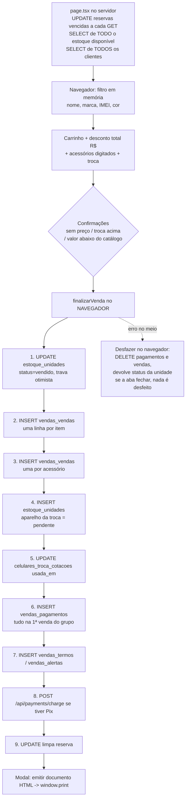
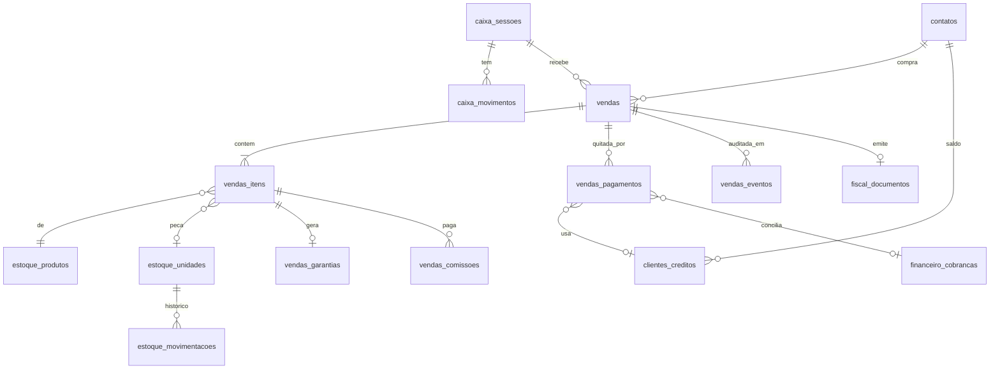

# Auditoria completa do módulo PDV — Nexus CRM

**Data:** 19/11/2026 · **Tipo:** só leitura. Nenhum código, migração ou dado foi alterado. O banco de produção foi consultado apenas com `SELECT` no catálogo (`pg_policies`, `pg_proc`, `pg_trigger`, `pg_constraint`) e contagens agregadas.
**Base:** `main` = `d64607e5`. Banco de produção `guiuzbcqkvelqcuogxtd`.

> **Por que o banco e não as migrações:** a produção não tem o histórico completo em `supabase/migrations` (só 83 arquivos desde o baseline de 19/10). RLS, triggers e funções foram lidos direto do catálogo de produção, que é o que vale.

---

## 1. Resumo executivo

O PDV é **uma tela grande de varejo de celular** ([pdv-view.tsx](../app/(dashboard)/pdv/components/pdv-view.tsx), 1.434 linhas), com duas abas: Pronta Entrega e Encomenda. O fechamento roda **inteiro no navegador**, em 8 a 12 gravações soltas com "desfazer" manual: não há RPC, transação nem regra de papel no servidor.

O isolamento entre empresas está **correto**: RLS em todas as tabelas, empresa resolvida no banco pelo `auth.uid()`. O que existe por dentro de uma empresa não tem controle nenhum.

**Nota "pronto para vender a terceiros": 2 / 10.**

Os 5 maiores problemas:
1. **Sem fiscal (NFC-e/NF-e) e sem caixa.** Abertura, sangria e fechamento não existem. Isso bloqueia qualquer lojista formal.
2. **O dinheiro não fecha em produção.** 93 encomendas entregues valem R$ 651.827, mas só R$ 156.947 estão em `vendas_pagamentos`. 52 não têm nenhum pagamento. Causa principal: o "Entregar" do Histórico conclui a venda sem gravar o saldo ([historico-view.tsx:174](../components/modules/historico/historico-view.tsx:174)).
3. **A venda não é atômica.** Venda, estoque, pagamentos, troca e termos são chamadas separadas do cliente ([pdv-view.tsx:355-757](../app/(dashboard)/pdv/components/pdv-view.tsx:355)). A venda pode fechar com "Falta R$ X" nos pagamentos.
4. **Permissões só na tela.** Qualquer membro (vendedor, técnico) pode fazer UPDATE/DELETE em `vendas_vendas` e `vendas_pagamentos` pela API. O limite de desconto por papel (`descontoMax`) existe na configuração e não é aplicado em lugar nenhum. Não há log de auditoria.
5. **Sem cancelamento, devolução, troca pós-venda, crediário ou vale-troca.** O status `cancelada` existe só como filtro: 0 vendas canceladas em toda a história.

---

## 2. Mapa do que existe hoje

### 2.1 Rotas e páginas

| Rota | Arquivo | O que faz | No menu? |
|---|---|---|---|
| `/pdv` | [app/(dashboard)/pdv/page.tsx](../app/(dashboard)/pdv/page.tsx) + `components/pdv-view.tsx` | Abas Pronta Entrega (vitrine de unidades + carrinho + pagamentos) e Encomenda (lançar, pedir, receber, entregar). A aba Reservas aparece quando há reserva de lead. | Sim, grupo Operação ([lib/menu.ts:314](../lib/menu.ts:314)) |
| `/historico` | [app/(dashboard)/historico/page.tsx](../app/(dashboard)/historico/page.tsx) + [components/modules/historico/historico-view.tsx](../components/modules/historico/historico-view.tsx) | Lista até 500 vendas: 2ª via de documento, transferir vendedor (admin), **Entregar** encomenda, CSV | Sim ([lib/menu.ts:315](../lib/menu.ts:315)) |
| `/orcamentos` (+ `/cotacao`, `/precos`, `/checklist`, `/parcela`) | `app/(dashboard)/orcamentos/*` | Orçamento, cotação de troca, matriz de preços de usado, simulador de parcela | Sim (`/parcela` como aba) |
| `/orcamento/[token]` | [app/orcamento/[token]](../app/orcamento/[token]/page.tsx) + [app/api/orcamento/[token]/route.ts](../app/api/orcamento/[token]/route.ts) | Página pública: o cliente aprova o orçamento e **cria venda com service_role** (linhas 114 e 195), fora do PDV | Pública por token |
| `/estoque`, `/estoque/imei` | `app/(dashboard)/estoque/*` | Unidades (série/lote), entrada, transferência entre lojas; consulta Anatel de IMEI | Sim; `/estoque/imei` é ferramenta |
| `/catalogo` | `app/(dashboard)/catalogo` | Produtos, categorias, marcas, tabela de preços de usado | Sim |
| `/compras` | `app/(dashboard)/compras` | Pedidos de compra; "Receber" dá entrada da unidade | Sim |
| `/garantia` | `app/(dashboard)/garantia/*` | Garantias (`assistencia_garantias`, sem `venda_id`) + fila de termos a assinar (`vendas_termos`) | Sim |
| `/financeiro` | `app/(dashboard)/financeiro` | Lançamentos e cobranças; dar baixa manual | Sim |
| `/relatorios` | `components/modules/relatorios/relatorios-view.tsx` | Período, vendedor, ticket, lucro, CSV | Sim (plano `bi`) |
| `/metas` | `app/(dashboard)/metas` | Meta de valor por vendedor (core) | Sim (admin) |
| `/ranking`, `/kds`, `/cardapio`, `/executivo`, `/simular-financiamento`, `/avaliacoes` | — | **Em preparação**: fora do menu e da trava, só o superadmin abre ([lib/menu.ts:434](../lib/menu.ts:434)) | Não |

Não achei rota órfã de verdade: tudo que existe está no menu, é ferramenta/aba ou está marcado como "em preparação".

### 2.2 Componentes

| Componente | Usado em | Observação |
|---|---|---|
| `pdv-view.tsx` (1.434 linhas) | `/pdv` | Busca, carrinho, desconto, acessórios, troca, pagamentos, fechamento, documentos, Pix: tudo num arquivo |
| `components/modules/pdv/encomenda-form.tsx` (602) | aba Encomenda | **Tela de pagamento e seletor de cliente próprios** |
| `components/modules/pdv/encomenda-fechar.tsx` (313) | aba Encomenda | **Terceira tela de pagamento** |
| `components/modules/pdv/encomendas-abertas.tsx` (588) | aba Encomenda | Lista, "pedido feito", "chegou", ajuste de valor |
| `components/modules/celulares/pdv-troca.tsx` (258) | `/pdv` | Troca de aparelho (importada direto pelo PDV) |
| `components/modules/orcamentos/troca-modal.tsx`, `avaliar-aparelho.tsx` | orçamentos | **Segunda implementação** de avaliação de troca |
| `app/(dashboard)/clientes/components/cliente-modal.tsx` | PDV, encomenda, clientes | Cadastro rápido (o mesmo componente nos dois fluxos) |
| `app/(dashboard)/orcamentos/cliente-autocomplete.tsx` | cotação, orçamento, troca | **Terceiro seletor de cliente**: este busca no servidor; o do PDV filtra em memória a lista inteira |

**Duplicações:**
- 3 listas fixas de formas de pagamento: [pdv-view.tsx:80](../app/(dashboard)/pdv/components/pdv-view.tsx:80), `encomenda-form.tsx:46`, `encomenda-fechar.tsx:36`.
- 3 caminhos que gravam `vendas_pagamentos`.
- 3 caminhos que criam venda, sem código comum: PDV, encomenda e orçamento por link.
- 3 seletores de cliente.
- 2 telas de troca.

### 2.3 APIs e funções ligadas ao PDV

| Rota | Lê / escreve | Observação |
|---|---|---|
| *(nenhuma)* — finalizar venda | — | **Não existe rota, server action nem RPC.** O PDV grava direto do navegador em `estoque_unidades`, `vendas_vendas`, `vendas_pagamentos`, `vendas_termos`, `vendas_alertas` e `celulares_troca_cotacoes` |
| `POST /api/payments/charge` | `financeiro_cobrancas` | Gera Pix no gateway da empresa (asaas, efibank, mercadopago, pagseguro, manual) |
| `POST /api/payments/webhook/[provider]` | `financeiro_cobrancas`, `financeiro_lancamentos` | Idempotente; **não toca na venda** |
| `/api/reservas` | `estoque_unidades` | Reserva de unidade para lead (48 h), cancelar |
| `/api/compras/receber` | `compras_pedidos`, `estoque_unidades`, `vendas_vendas.unidade_id` | Entrada da peça da encomenda |
| `/api/estoque/transferir`, `/confirmar-chegada` | `estoque_unidades`, `estoque_movimentacoes` | Única fonte de linhas em `estoque_movimentacoes` |
| `/api/orcamento/[token]` | `vendas_vendas` (service_role) | Venda criada por aprovação pública |
| `/api/troca/*`, `/api/taxas`, `/api/contrato-*`, `/api/garantia/termo`, `/api/exportar`, `/api/whatsapp/send` | módulos satélite | — |

Funções no banco ligadas a venda ou estoque (produção): só `estoque_item_sync`, `numerar_cotacao_troca`, `tg_zapintel_vendas_ao_vivo` e `zapintel_posvenda`. **Nenhuma** de venda, caixa, comissão ou baixa de estoque.

### 2.4 Banco: tabelas do PDV (produção)

Todas têm `empresa_id` e **RLS ativa**. As de movimento também têm `filial_id`, preenchido pelo trigger `preencher_filial`.

| Tabela | Colunas principais | FKs | Política |
|---|---|---|---|
| `vendas_vendas` | id, empresa_id, filial_id, grupo_pdv (uuid), cliente_id, vendedor_id, usuario_id, produto_id, unidade_id, quantidade, valor_venda, valor_custo, lucro (gerada), desconto_valor, **desconto_motivo, desconto_aprovado_por (nunca preenchidas)**, forma_pagamento, parcelas, canal_venda, status, comissao (sem uso), numero_serie, comanda, pedido_compra_id, previsao_entrega | contatos, usuarios ×3, estoque_produtos, estoque_unidades, compras_pedidos, filiais | `tenant_isolamento` ALL (empresa + filiais visíveis) + restritivas `somente_leitura_*` (empresa ativa) |
| `vendas_pagamentos` | venda_id, forma_pagamento, valor_pago, bandeira_cartao, parcelas, valor_com_juros | vendas_vendas ON DELETE CASCADE | igual |
| `vendas_termos` | venda_id, tipo (garantia/troca), status, arquivo_url, assinado_em | — | select/insert/update por empresa+filial |
| `vendas_alertas` | venda_id, tipo, mensagem, valor_referencia, valor_informado, aceito_por | — | só select/insert (log imutável) |
| `vendas_comissoes` | venda_id, usuario_id, valor_comissao, percentual, status, mes_referencia | — | ALL · **0 linhas** |
| `vendas_pre_vendas` | inventario_unidade_id, produto_id, vendedor_id, valor_venda, status, venda_id | — | ALL · **0 linhas, nenhum código usa** |
| `vendas_contratos`, `vendas_contrato_modelos`, `vendas_contrato_documentos` | documentos emitidos e modelos | — | modelos só dono/admin |
| `estoque_unidades` | produto_id, imei, imei2, numero_serie, cor, armazenamento, bateria, condicao, estado, preco_custo, preco_venda, quantidade (lote), status, tipo, grupo_pdv, cliente_id, fornecedor_id, reservado_*, recebido_*, **placa, chassi, renavam, km, ano** | produtos, contatos, negocios, fornecedores, filiais | ALL por empresa+filial · CHECK quantidade ≥ 0 |
| `estoque_produtos` | nome, marca_id, categoria_id, cores[], armazenamentos[], preco, garantia_dias, **codigos (texto livre, sem uso)** | marcas, categorias | ALL por empresa (sem filial) |
| `estoque_movimentacoes` | produto_id, tipo_movimento, quantidade | — | **0 linhas** |
| `financeiro_taxas` | forma_pagamento, bandeira, parcelas, percentual_taxa | — | ALL por empresa |
| `financeiro_cobrancas` | provider, provider_ref, valor, status, venda_id, qr_code, pago_em | — | membro ativo |
| `financeiro_config_pagamento` | provider, credenciais_cipher, modo | — | escrita dono/admin · **0 linhas (nenhum gateway configurado)** |
| `celulares_troca_cotacoes` | numero, modelo, imei, valor_final, usada_em, venda_id | — | ALL por empresa+filial |
| `contatos` | cliente (nome, telefone, cpf_cnpj, endereco, dados jsonb) | — | por empresa |

Enums: nenhum. Status e formas de pagamento são `text` livre, sem CHECK. `vendas_vendas.status` assume, na prática, `concluida | encomenda | pendente_entrega | cancelada | devolvido`.

### 2.5 Fluxo atual de venda (Pronta Entrega)

Na encomenda: **lançar** (compras_pedidos + vendas `encomenda` + sinal) → **pedido feito** (admin) → **chegou** (`/api/compras/receber`: unidade reservada) → **entregar**. O entregar tem dois caminhos: a aba Encomenda grava o saldo, o **Histórico não**.

### 2.6 O que os dados de produção mostram (JM, empresa 1)

| Medida | Valor |
|---|---|
| Fechamentos pela **Pronta Entrega** (`canal_venda = loja_fisica`) | **3 grupos / 4 linhas, R$ 14.285**, pagamentos 100% batendo |
| Encomendas concluídas | **93 grupos, R$ 651.827 vendidos × R$ 156.947 em pagamentos** |
| … sem nenhum pagamento | 52 (26 só em outubro, 17 em novembro: o buraco continua aberto) |
| … com pagamento diferente da venda (> R$ 1) | 27 |
| … batendo | 14 |
| Vendas canceladas, com desconto, com motivo de desconto | 0 / 0 / 0 |
| `vendas_comissoes`, `estoque_movimentacoes`, `vendas_pre_vendas` | 0 / 0 / 0 |
| Gateway de pagamento configurado | nenhum (2 cobranças "manual pendente") |
| Unidades em estoque | 7 disponíveis, 18 vendidas, 1 reservada, **23 pendentes** (troca/entrada ainda não recebida) |

**Leitura:** a JM usa o PDV quase só como **livro de encomendas**. O balcão de pronta entrega praticamente não roda em produção, então o código mais elaborado é o menos testado pelo uso real.

---

## 3. Checklist completo

Legenda: ✅ completo · 🟡 incompleto · 🔴 reconstruir · ⚫ não existe · 🔗 solto (existe, não integrado)

### A. Núcleo de venda

| Item | Status | Evidência | O que falta |
|---|---|---|---|
| Busca por nome/código/barras/SKU | 🟡 | Filtro em memória por nome, marca, IMEI, cor e armazenamento ([pdv-view.tsx:196-204](../app/(dashboard)/pdv/components/pdv-view.tsx:196)). `estoque_produtos` não tem SKU nem EAN; `codigos` é texto livre sem uso. `numero_serie`, onde mora o "código de barras" do lote ([lib/estoque-campos.ts:52](../lib/estoque-campos.ts:52)), **não entra no filtro** | SKU/EAN no produto; busca no servidor; leitor USB: Enter adiciona direto ao carrinho |
| Carrinho: adicionar, remover, quantidade, observação | 🟡 | Adicionar/remover/quantidade de lote ok (`pdv-view.tsx:214-247`) | Observação por item |
| Desconto por item e total (R$ e %), com motivo | 🟡 | Só desconto total em R$, rateado ([pdv-view.tsx:278, 406-416](../app/(dashboard)/pdv/components/pdv-view.tsx:406)). `desconto_motivo` existe e nunca é gravado | Desconto por item, em %, motivo obrigatório |
| Limite de desconto por perfil + liberação de gerente | 🔗 | `descontoMax` por papel em [lib/permissoes.ts:41-46](../lib/permissoes.ts:41), editável na tela de permissões, **não lido pelo PDV**. `desconto_aprovado_por` existe sem uso | Aplicar no servidor; fluxo de liberação com senha/PIN do gerente |
| Acréscimo/frete | ⚫ | Não encontrado no PDV | Campo de acréscimo/frete na venda |
| Venda com e sem cliente | ✅ | `cliente_id` opcional; "Sem cliente" no histórico (`page.tsx:185`) | — |
| Cadastro rápido de cliente sem sair | ✅ | `ClienteModal` dentro do PDV (`pdv-view.tsx` ~1180); `clientesNovos` mantém o recém-criado | (desempenho: ver H) |
| Vendedor diferente do operador | ⚫ | `vendedor_id: user.id` fixo ([pdv-view.tsx:462](../app/(dashboard)/pdv/components/pdv-view.tsx:462)). Só "Transferir" no Histórico depois, admin, sem log | Seletor de vendedor na venda |
| Orçamento salvo / venda suspensa | 🔗 | Módulo Orçamentos existe e o link público cria venda direto ([api/orcamento/[token]/route.ts:114](../app/api/orcamento/[token]/route.ts:114)), sem passar pelo PDV nem pela baixa de estoque dele. Não há "suspender carrinho" | Puxar orçamento para o carrinho; suspender e retomar |
| Cancelamento com motivo, estorno e log | ⚫ | Nenhum código grava `cancelada`; só rótulo e filtro (`historico-view.tsx:47-48, 188`). 0 canceladas em produção | Tudo |
| Atalhos de teclado | ⚫ | Só `Esc` fecha o seletor de cliente (`pdv-view.tsx:190-194`) | F2 busca, F4 cliente, F8 pagamento, F10 finalizar etc. |
| Comprovante: térmica 80 mm, PDF, WhatsApp | 🟡 | Documentos/contratos em HTML via `window.print` ([lib/contrato-tipos.ts:80](../lib/contrato-tipos.ts:80)); "PDF" só pelo imprimir do navegador; WhatsApp só envia a chave Pix (`pdv-view.tsx:767-781`) | Cupom não fiscal 80 mm, PDF real, envio do comprovante |

### B. Pagamentos

| Item | Status | Evidência | O que falta |
|---|---|---|---|
| Várias formas na mesma venda (split) | 🟡 | Linhas de pagamento ok, gravadas na 1ª venda do grupo (`pdv-view.tsx:580-610`). **O botão finalizar não exige pagamento fechado**: mostra "Falta R$ X" e deixa fechar (`pdv-view.tsx:1409-1421`; `finalizarVenda` não confere `resumoPag.fechado`) | Bloquear com falta/sobra; validar soma = total no servidor |
| Dinheiro com troco | 🟡 | Mostra "Passou R$ X" ([lib/pdv-pagamentos.ts:79-81](../lib/pdv-pagamentos.ts:79)); sem campo "valor recebido" nem troco. O excedente é gravado como pago | Valor recebido × troco, gravando só o devido |
| Pix com QR dinâmico e confirmação | 🟡 | QR pelo gateway (`/api/payments/charge`); o webhook atualiza só `financeiro_cobrancas` e **não a venda**; o PDV não espera a confirmação. JM sem gateway configurado | Venda "aguardando Pix" → confirmada pelo webhook; Pix manual com comprovante |
| Cartão: parcelas, bandeira, taxa | 🟡 | `financeiro_taxas` forma × bandeira × parcelas; grava bandeira, parcelas e `valor_com_juros`. A taxa é **repassada ao cliente**; o custo de MDR da loja não entra na margem | Taxa do lojista (MDR) como custo; NSU/autorização |
| Integração TEF/POS | ⚫ | Busquei stone, cielo, getnet, sumup, sitef, tef, point: nada. "Maquininha" é só rótulo de taxa | Decisão de provedor |
| Crediário/fiado | ⚫ | Busquei crediario, fiado, saldo em aberto: nada | Tudo |
| Vale-troca / crédito do cliente | ⚫ | Não encontrado | Tudo |
| Trade-in como pagamento, entrando como seminovo | ✅ | Troca entra como unidade `usado/troca/pendente` com IMEI e custo (`pdv-view.tsx:541-549`), pagamento `troca` (596-602), cotação marcada (562-575), termo automático (619-625), aceite acima da referência em `vendas_alertas`. Confirmação de chegada em `/api/estoque/confirmar-chegada` | Fica preso ao módulo Celulares (ver H) e à falta de atomicidade |

### C. Caixa

| Item | Status | Evidência | O que falta |
|---|---|---|---|
| Abertura com fundo de troco | ⚫ | Busquei caixa, sangria, suprimento, abertura, fechamento, cash register em app, lib, components, types e migrations: só texto de marketing (`app/landing/data.ts:106`) | Tudo |
| Sangria e suprimento com motivo | ⚫ | idem | Tudo |
| Fechamento com conferência e diferença | ⚫ | idem | Tudo |
| Um caixa por operador/terminal; venda bloqueada com caixa fechado | ⚫ | idem | Tudo |
| Relatório de fechamento imprimível | ⚫ | idem | Tudo |
| Histórico de caixas por loja | ⚫ | idem | Tudo |

### D. Estoque integrado

| Item | Status | Evidência | O que falta |
|---|---|---|---|
| Baixa automática e **atômica** na venda | 🔴 | Baixa existe, com trava otimista (`.eq('status', esperado)`, `.gte('quantidade')`, `pdv-view.tsx:432-455`), mas é chamada solta do navegador, com desfazer no cliente. Não grava `estoque_movimentacoes` (0 linhas) | RPC transacional + livro de movimentação |
| Estoque por loja e visão da rede no PDV | 🟡 | Por loja via RLS (`filiais_visiveis()`), sólido; dono/admin escolhe loja ou rede. O vendedor no PDV vê **só a loja dele**; nenhuma tela mostra "tem em Jaguariúna" | Consulta "disponível na rede" no PDV + pedido de transferência |
| Bloqueio de venda sem estoque | ✅ | Só lista unidades `disponivel`; lote não passa do saldo (`pdv-view.tsx:226-241`) e o UPDATE confere (`gte`) | — |
| IMEI específico obrigatório | ✅ | Pronta entrega vende a **unidade** (cada cartão é uma peça com IMEI); a encomenda copia o IMEI da unidade na entrega ([lib/encomendas.ts:162-175](../lib/encomendas.ts:162)) | O cadastro da unidade não exige IMEI em categoria serializada |
| Rastreabilidade por IMEI | 🔗 | Os dados se ligam (`vendas_vendas.unidade_id/numero_serie`, `estoque_unidades.fornecedor_id/recebido_em/cliente_id`), mas não há tela. `/estoque/imei` só consulta a Anatel (`check-imei-view.tsx:88`); a OS acha a venda pela série (`os-modal.tsx:141-182`) | Tela "IMEI → entrada → venda → cliente → garantia → OS" |
| Reserva para cliente | ✅ | Reserva de 48 h para lead (`/api/reservas`), aba Reservas no PDV, expiração preguiçosa (`page.tsx:30-36`) | A expiração roda como UPDATE em todo GET do PDV (efeito colateral na renderização) |

### E. Pós-venda

| Item | Status | Evidência | O que falta |
|---|---|---|---|
| Troca produto por produto | ⚫ | Não encontrado (a "troca" do PDV é trade-in, outra coisa) | Tudo |
| Devolução com vale-troca ou estorno | ⚫ | `devolvido` é só rótulo. `devolucao-card.tsx` trata de devolver **lead** à esteira | Tudo |
| Garantia ligada a serial e venda, com vencimento | 🔗 | `assistencia_garantias` **sem `venda_id`**, prazo digitado à mão (`garantia-modal.tsx:26-27`); `vendas_termos` liga o termo à venda; a OS calcula o prazo pela data da venda + padrão da loja, ignorando `estoque_produtos.garantia_dias` | Garantia gerada na venda (venda_id, unidade_id, vence_em) |
| Histórico do cliente no PDV | ⚫ | Não existe no PDV. **Bug:** "Compras / Total gasto / Última compra" em Clientes nunca são calculados ([clientes-view.tsx:213-218](../app/(dashboard)/clientes/components/clientes-view.tsx:213); [lib/clientes.ts](../lib/clientes.ts) não preenche) e aparecem sempre 0/— | Resumo do cliente no carrinho; consertar a lista de clientes |

### F. Venda inteligente

| Item | Status | Evidência | O que falta |
|---|---|---|---|
| Pré-venda no celular, finalizada no caixa | ⚫ | `vendas_pre_vendas` existe em produção com RLS, **0 linhas, nenhum código usa** | Tela mobile + código/QR + puxar no caixa |
| Compre junto | 🟡 | "Ofertar acessórios" com sugestão fixa `['Acessório']` digitada à mão (`pdv-view.tsx:89, 327-338`), sem produto nem estoque | Sugestão por produto relacionado, saindo do estoque |
| Histórico e preferências do cliente na tela | 🔗 | O CRM tem negócio (`produto_interessado`), etiquetas, ficha do ZapIntel, conversas, mas o PDV não mostra nada | Painel do cliente no carrinho |
| Ranking e meta no PDV | 🔗 | `/metas` existe; `/ranking` em preparação; nada no PDV | Barra de meta do vendedor no PDV |
| Comissão por venda/vendedor | 🟡 | Comissão **mensal** = % padrão × soma das vendas (`equipe-view.tsx:405, 467-470`); `vendas_comissoes` sem `venda_id` e com 0 linhas; `vendas_vendas.comissao` sem uso | Regra por venda/produto/margem, gravada na venda |
| Tabelas de preço e desconto progressivo | ⚫ | `estoque_tabela_precos` é referência de **usado** para troca, não varejo/atacado | Tudo |
| Promoções com vigência | ⚫ | Não encontrado | Tudo |
| Campos customizados de cliente/produto | 🔗 | Campos personalizados do core existem em contato/negócio ([core/campos.ts](../core/campos.ts)); produto não tem; o PDV não usa | Ligar ao cadastro rápido e ao produto |
| Integração com o CRM | 🔗 | Reserva nasce no lead; trigger `zapintel_vendas_ao_vivo` e `zapintel_posvenda` leem vendas. A venda **não move o card**, não cria tarefa de pós-venda, não dispara mensagem | Evento "venda concluída" → Automatize (ganhar negócio, tarefa, mensagem) |

### G. Fiscal

| Item | Status | Evidência | O que falta |
|---|---|---|---|
| NFC-e / NF-e | ⚫ | Busquei nfce, nfe, focusnfe, enotas, plugnotas, nuvem fiscal, sefaz: **nada** | Tudo |
| Dados fiscais do produto (NCM, CFOP, CST/CSOSN, origem) | ⚫ | Busquei ncm, cfop, cst, csosn: nada | Tudo |
| Dados fiscais da empresa (CNPJ, IE, regime, certificado) | ⚫ | `filiais.cnpj` existe; IE, regime tributário e certificado não | Tudo |
| Contingência | ⚫ | — | Tudo |

**Não existe NADA fiscal.** Para vender a qualquer lojista que emite nota (a maioria), é o bloqueador número 1.

### H. Robustez, segurança e SaaS

| Item | Status | Evidência | O que falta |
|---|---|---|---|
| RLS por empresa em todas as tabelas do PDV | ✅ | RLS ativa em todas (§2.4); empresa vem de `get_empresa_id()` (SECURITY DEFINER, `auth.uid()` → `empresa_usuarios`, impersonação com TTL); `is_super_admin`/`impersonando_*`/`filial_atual_id` não são graváveis pelo cliente; `somente_leitura_*` são RESTRICTIVE (255 políticas). Isolamento testado em 27 tabelas × 3 usuários no Supabase local em 16/11 | Ponto de atenção: `get_empresa_id()` usa `LIMIT 1` **sem ORDER BY**. Usuário com 2 empresas cai numa indeterminada |
| Permissões por perfil no servidor | 🔴 | `tenant_isolamento` é `ALL` para qualquer membro em `vendas_vendas`, `vendas_pagamentos`, `estoque_unidades`, `vendas_comissoes`: o vendedor pode alterar/apagar venda, pagamento, preço e status de estoque pela API REST. O `/pdv` não exige papel (o técnico vende). Transferir vendedor só é travado na tela (`historico-view.tsx:160, 219`) | Escrita de venda/caixa/estoque só por RPC com regra de papel; RLS de UPDATE/DELETE restrita |
| Log de auditoria | ⚫ | Só `vendas_alertas` (aceite de troca). Sem log de desconto, transferência, alteração de preço (`unidade-modal.tsx:157`) ou exclusão de lançamento (`financeiro-view.tsx:241`). Nenhum trigger de auditoria | Tabela de auditoria gravada pelas RPCs |
| Offline / degradação | ⚫ | `public/sw.js` só mostra `/offline`; nada guardado em cache | Decisão de negócio (§9) |
| Desempenho | 🟡 | Índices bons em `vendas_vendas`/`estoque_unidades` (empresa+status, imei, série, grupo_pdv, filial). Mas a página carrega **todo** o estoque disponível e **todos** os clientes sem limite, e filtra em memória (`page.tsx:49-65`); o fechamento faz 8–12 chamadas em série; cada GET roda um UPDATE | Busca paginada no servidor; RPC única no fechamento |
| Tablet e celular | 🟡 | Layout responsivo (2 colunas a partir de `lg`, alvos de toque maiores no celular, `pdv-view.tsx:1065, 1211`); nunca testado em tablet | Teste em tablet; modo balcão |
| Safari | 🟡 | Nada específico encontrado. Sessão em cookie first-party, mesma origem, o que reduz o risco de ITP. O adaptador `sessionStorage` em `lib/supabase/client.ts:4-18` é **ignorado** pelo `@supabase/ssr` (o comentário engana). Não testado no Safari | Teste e2e em WebKit |
| Configurações do PDV por empresa | 🟡 | Módulo liga/desliga (trava de **tela** no `proxy.ts:312-394`); taxas, tolerância de troca, garantia padrão e comanda são por empresa. **Formas de pagamento fixas no código**; sem impressora; sem trava de módulo na **escrita** (RLS não olha o módulo) | Formas configuráveis, impressora, trava de módulo nas RPCs |
| Multi-segmento / desligável | 🟡 | Desligar o PDV não quebra outras telas (ninguém importa de `app/(dashboard)/pdv`). Mas o PDV importa direto do módulo Celulares (`pdv-troca`, `PDV_CELULAR`, `celulares_troca_cotacoes`) e do Cardápio; `estoque_unidades` mistura colunas de celular e de veículo (placa, chassi, renavam, km). Para a Aletrini não serve: veículo é proposta, financiamento, documentação e entrega, não balcão | Separar núcleo de venda × extensões de segmento |

### I. Relatórios

| Item | Status | Evidência | O que falta |
|---|---|---|---|
| Vendas por período, loja, vendedor, forma, produto, categoria | 🟡 | Período e vendedor (`relatorios-view.tsx:206-215`); loja pelo seletor do topo; top 6 produtos no painel. Sem forma de pagamento, categoria ou comparativo de lojas, e com os pagamentos incompletos (§2.6) o relatório por forma estaria errado de qualquer jeito | Relatórios por forma/categoria/loja |
| Ticket médio, itens por venda, margem | 🟡 | Ticket e lucro (com custo) (`relatorios-view.tsx:217-245`); sem itens por venda e sem margem por produto | — |
| Curva ABC | ⚫ | Não encontrado | — |
| Exportação CSV/Excel | ✅ | CSV de vendas, lançamentos, clientes e estoque (`relatorios-view.tsx:79-160`, `/api/exportar`) | .xlsx nativo (opcional) |

### Contagem

| Status | Itens |
|---|---|
| ✅ Completo | **8** |
| 🟡 Incompleto | **18** |
| 🔴 Reconstruir | **2** |
| ⚫ Não existe | **26** |
| 🔗 Solto | **8** |
| **Total** | **62** |

---

## 4. SOLTO / NÃO INTEGRADO

| Existe em | Onde deveria se conectar ao PDV |
|---|---|
| `descontoMax` por papel ([lib/permissoes.ts](../lib/permissoes.ts)) + colunas `desconto_motivo`/`desconto_aprovado_por` | Validação do desconto na RPC de fechamento; liberação do gerente grava `desconto_aprovado_por` |
| Orçamentos + aprovação por link (`/api/orcamento/[token]`, que cria venda própria com service_role) | Orçamento aprovado vira **venda pendente** que o PDV puxa para o carrinho; uma só porta de criação de venda |
| `vendas_pre_vendas` (tabela pronta, sem código) | Base da pré-venda mobile (P2) |
| `vendas_comissoes` + `vendas_vendas.comissao` (sem uso) | Comissão calculada por venda na RPC; o fechamento mensal soma |
| `estoque_movimentacoes` (só a transferência grava) | Toda entrada, venda, troca, devolução e ajuste gera linha |
| `estoque_produtos.codigos` (texto) e `garantia_dias` | SKU/EAN pesquisável; garantia gerada na venda com `vence_em` |
| `assistencia_garantias` (sem `venda_id`) e `vendas_termos` | Garantia nasce da venda + unidade; OS lê a garantia, não recalcula |
| Webhook de pagamento (`financeiro_cobrancas`) | Confirmar a venda/pagamento Pix; PDV acompanha "aguardando Pix" |
| `financeiro_lancamentos` (receita do webhook) | Caixa e conciliação: venda gera lançamento; hoje só o Pix pelo webhook gera |
| Campos personalizados do core, etiquetas, negócio, ficha ZapIntel | Painel do cliente no carrinho; cadastro rápido com os campos obrigatórios da empresa |
| Automatize (gatilhos) | Gatilho "venda concluída" → ganhar negócio, tarefa de pós-venda, mensagem de agradecimento/avaliação |
| `/metas` e `lib/ranking.ts` | Barra de meta do vendedor no PDV |
| Seletor de loja + RLS por filial | Consulta "disponível na rede" e pedido de transferência a partir do PDV |

---

## 5. RECONSTRUIR (não vale remendar)

1. **O fechamento da venda** (`finalizarVenda`, `pdv-view.tsx:355-757`; `encomenda-form`; `encomenda-fechar`; `lib/encomendas.ts`; `/api/orcamento/[token]`).
   - Cinco portas criam ou concluem venda, cada uma gravando pagamento do seu jeito, e uma delas (Histórico → Entregar) perde o dinheiro.
   - Não é atômico: aba fechada ou rede caindo no meio deixa peça "vendida" sem venda, ou venda sem pagamento.
   - O desfazer no navegador apaga dados com a mesma permissão que o vendedor tem. Remendar significaria repetir as regras em 5 lugares.
   - **Substituir por** uma RPC `vendas_fechar(payload)` SECURITY DEFINER em transação: valida papel, desconto, caixa aberto e soma dos pagamentos; baixa estoque; grava movimentação, comissão e auditoria. As telas só montam o payload.
2. **O modelo "venda = linha por item, amarrada por `grupo_pdv`".**
   - Não há cabeçalho de venda: o total, o cliente, os pagamentos e o documento vivem "na primeira linha do grupo".
   - Todo relatório e todo invariante ("soma dos pagamentos = soma das vendas") vira consulta por uuid.
   - Cancelamento parcial, devolução de um item e NFC-e (que é por documento) ficam improváveis.
   - **Substituir por** cabeçalho `vendas` + `vendas_itens` (§7).
3. **Permissões de escrita por RLS `ALL` para qualquer membro.** Não se corrige com tela: a escrita de venda, pagamento, caixa e estoque precisa sair do cliente e passar pelas RPCs, com RLS só de leitura para o papel comum.

Fica de pé e é reaproveitável: o isolamento por empresa/filial (RLS + `get_empresa_id` + `preencher_filial`), a lógica de parcelas e juros (`lib/pdv-pagamentos.ts`), o fluxo de troca (regra de referência e aceite), a reserva para lead, o ciclo de encomenda (como fluxo de tela), a emissão de documentos e o aviso de valor abaixo do catálogo.

---

## 6. Riscos críticos

### Segurança
- **Vazamento entre empresas: baixo.** RLS em todas as tabelas, empresa resolvida no banco, colunas de impersonação protegidas. Nenhum `service_role` no navegador (o PDV usa o cliente anon + sessão).
- **Dentro da empresa, aberto:** vendedor ou técnico pode, pela API REST com o próprio token, fazer UPDATE/DELETE de `vendas_vendas`, `vendas_pagamentos` (inclusive de outro vendedor, na mesma loja) e alterar `estoque_unidades.preco_venda/status`. Nada fica registrado.
- `get_empresa_id()` com `LIMIT 1` sem ordem: um usuário ligado a duas empresas (cenário real quando o Lucas ou um contador entra em mais de uma) cai numa empresa indeterminada.
- `/api/orcamento/[token]` cria venda com service_role a partir de página pública. Confere o módulo `orcamentos`, mas não passa pela baixa de estoque do PDV.
- A trava de módulo vale só para a tela. Com o PDV desligado, a escrita continua possível pela API.

### Integridade
- **Dinheiro sem registro:** R$ 494.880 de diferença entre vendas concluídas e pagamentos registrados nas encomendas (§2.6). O caminho Histórico → Entregar continua ativo e continua gerando o buraco (17 em novembro).
- A venda pode ser finalizada com pagamentos que não somam o total (falta ou sobra).
- Fechamento em 8–12 chamadas: falha no meio deixa estado parcial. O desfazer depende de a aba continuar aberta.
- Sem livro de movimentação: o saldo de estoque não é auditável (0 linhas em `estoque_movimentacoes` fora transferência).
- 23 unidades `pendente` (trocas/entradas não confirmadas): a comissão do fechamento "espera" algo que ninguém acompanha.
- O webhook Pix marca a cobrança e não a venda: dupla verdade sobre o que foi pago.
- Na lista de clientes, "Compras/Total gasto" sempre zerado: número errado mostrado como verdadeiro.

### Fiscal
- **Zero.** Sem NFC-e/NF-e, sem dados fiscais do produto e da empresa, sem certificado, sem contingência. Para vender a terceiros, é bloqueador absoluto (exceto para quem não emite nota pelo PDV, como revenda de veículos usados, que emite NF-e de outro jeito).

---

## 7. Modelo de dados proposto

Princípios: tudo com `empresa_id` + `filial_id` + RLS de **leitura** por empresa/filial; **escrita só por RPCs** SECURITY DEFINER que conferem papel e módulo; prefixos do módulo (regra "tudo é módulo"); dinheiro em `numeric(12,2)`; status com CHECK.

| Tabela | Colunas principais | Hoje |
|---|---|---|
| `vendas` (cabeçalho, nova) | numero (sequência por filial), cliente_id, vendedor_id, operador_id, caixa_sessao_id, status (`rascunho, suspensa, aguardando_pagamento, concluida, cancelada, devolvida_parcial, devolvida`), tipo (`balcao, encomenda, orcamento, pre_venda`), subtotal, desconto_valor, desconto_motivo, desconto_aprovado_por, acrescimo, total, origem_orcamento_id, negocio_id, cancelada_em/por/motivo | Não existe: o cabeçalho é a "1ª linha do grupo" |
| `vendas_itens` (nova) | venda_id, produto_id, unidade_id, descricao, quantidade, preco_unit, desconto_item, total_item, custo_unit, observacao, comissao_valor, devolvido_qtd | É `vendas_vendas` (1 linha = 1 item + dados de cabeçalho repetidos) |
| `vendas_pagamentos` | venda_id, forma (FK para `vendas_formas_pagamento`), valor, valor_recebido, troco, parcelas, bandeira, taxa_lojista, nsu/autorizacao, cobranca_id, credito_id, status | Existe, sem troco/NSU/status; pendurada na 1ª linha |
| `vendas_formas_pagamento` (nova) | empresa_id, chave, nome, tipo (dinheiro/pix/cartao/crediario/credito/troca), ativo, exige_cliente, taxa_padrao | Lista fixa no código, em 3 lugares |
| `caixa_sessoes` (nova) | filial_id, terminal, operador_id, aberto_em, fundo_troco, fechado_em, esperado_por_forma jsonb, informado_por_forma jsonb, diferenca, fechado_por | Não existe |
| `caixa_movimentos` (nova) | sessao_id, tipo (sangria/suprimento/venda/estorno/troco), valor, forma, motivo, usuario_id | Não existe |
| `estoque_movimentacoes` | unidade_id, produto_id, tipo (entrada/venda/devolucao/troca/ajuste/transferencia), quantidade, origem (venda_item_id…), usuario_id | Existe, só a transferência grava |
| `estoque_produtos` | + sku, ean[], ncm, cest, cfop_padrao, csosn/cst, origem, unidade_comercial, serializado bool | Sem fiscal, sem SKU/EAN |
| `estoque_unidades` | núcleo genérico (série, custo, preço, status, filial) + **atributos do segmento em jsonb/tabela de extensão** (`celulares_unidades`: imei, bateria; `veiculos_unidades`: placa, chassi, renavam, km) | Mistura colunas de celular e veículo |
| `vendas_garantias` (nova ou `assistencia_garantias` + FKs) | venda_item_id, unidade_id, inicio, vence_em, termo_id | Sem `venda_id`, prazo digitado |
| `vendas_comissoes` | venda_item_id, usuario_id, regra, base, percentual, valor, status | Existe sem uso; comissão é mensal sem vínculo |
| `clientes_creditos` (nova) | contato_id, tipo (vale_troca/crediario), valor, saldo, vence_em, origem_venda_id | Não existe |
| `vendas_eventos` (nova, só insert) | venda_id, tipo (desconto_liberado, cancelada, vendedor_trocado, preco_alterado…), antes/depois jsonb, usuario_id | Só `vendas_alertas` (troca) |
| `fiscal_config` / `fiscal_documentos` (novas, módulo Fiscal) | por filial: cnpj, ie, regime, csc, certificado (cofre), ambiente; documento: venda_id, modelo (65/55), chave, status, xml_url, danfe_url, protocolo, contingencia | Não existe |
| `vendas_pre_vendas` | reaproveitar como "pré-venda": codigo curto/QR, itens jsonb, vendedor_id, expira_em, venda_id | Existe sem uso |

Migração dos dados: `vendas_vendas` agrupada por `grupo_pdv` vira cabeçalho + itens (88 a 120 linhas hoje, volume trivial). Os pagamentos sobem para o cabeçalho. As 52 encomendas sem pagamento ficam com status `pagamento_nao_registrado` para a loja conferir; **não inventar** pagamento.

---

## 8. Roadmap priorizado

### P0 — bloqueadores (uso em produção e venda)

| # | Item | Dependências | Tamanho |
|---|---|---|---|
| P0.1 | **Estancar o buraco do dinheiro já:** o "Entregar" do Histórico passa a abrir o mesmo fechamento da aba Encomenda (ou some), e a lista das 52+27 encomendas vai para a loja conferir | nenhuma | P |
| P0.2 | Cabeçalho `vendas` + `vendas_itens` + migração dos dados | decisão do modelo (§7) | G |
| P0.3 | RPC única `vendas_fechar` (transação: papel, desconto, soma dos pagamentos, baixa, movimentação, comissão, auditoria), usada por balcão, encomenda e orçamento | P0.2 | G |
| P0.4 | Escrita de venda/pagamento/estoque só via RPC; RLS de UPDATE/DELETE restrita; `get_empresa_id` determinístico | P0.3 | M |
| P0.5 | Cancelamento com motivo + estorno de estoque e pagamento + log | P0.3 | M |
| P0.6 | **Caixa:** abertura, sangria/suprimento, fechamento cego com diferença, venda exige caixa aberto, relatório | P0.2, formas configuráveis | G |
| P0.7 | Formas de pagamento por empresa (tabela), troco, bloqueio de falta/sobra | P0.2 | M |
| P0.8 | **Fiscal NFC-e** (módulo Fiscal: dados do produto, da filial, certificado, emissão, cancelamento, contingência) via provedor | decisão do provedor (§9) | G |
| P0.9 | Limite de desconto por papel + liberação de gerente (PIN) | P0.3 | M |
| P0.10 | Testes e2e do fechamento (o `pdv-e2e.mjs` atual está obsoleto: usa views removidas) | P0.3 | M |

### P1 — essencial para competir

| # | Item | Dependências | Tamanho |
|---|---|---|---|
| P1.1 | Busca no servidor por nome/SKU/EAN/IMEI; leitor USB adiciona com Enter; atalhos de teclado | SKU/EAN no produto | M |
| P1.2 | Desconto por item e em %; acréscimo/frete; observação por item | P0.2 | P |
| P1.3 | Vendedor ≠ operador na venda | P0.2 | P |
| P1.4 | Suspender/retomar venda; orçamento → carrinho | P0.2/P0.3 | M |
| P1.5 | Cupom não fiscal 80 mm + PDF + envio por WhatsApp | P0.2 | M |
| P1.6 | Pix conciliado: venda "aguardando Pix" confirmada pelo webhook | P0.3 | M |
| P1.7 | Devolução e troca pós-venda com vale-troca/estorno; `clientes_creditos` | P0.5 | G |
| P1.8 | Garantia gerada na venda (vence_em) + tela de rastreio por IMEI | P0.2 | M |
| P1.9 | Estoque da rede no PDV + pedido de transferência | — | P |
| P1.10 | Relatórios: forma de pagamento, categoria, loja, margem, ABC, fechamento de caixa | P0.2, P0.6 | M |
| P1.11 | Corrigir "Compras/Total gasto/Última compra" em Clientes; histórico do cliente no PDV | P0.2 | P |
| P1.12 | Comissão por venda (regra por papel/produto/margem) | P0.3 | M |
| P1.13 | Separar núcleo de venda × Celulares (troca/IMEI como extensão) | P0.3 | M |
| P1.14 | Crediário com parcelas em aberto por cliente | `clientes_creditos`, decisão (§9) | G |

### P2 — diferenciais

| # | Item | Dependências | Tamanho |
|---|---|---|---|
| P2.1 | Pré-venda no celular → código/QR → caixa finaliza | P0.3, P1.4 | M |
| P2.2 | Compre junto por produto relacionado (do estoque) | P1.1 | M |
| P2.3 | Painel do cliente no carrinho (negócio, etiquetas, ficha ZapIntel, compras) | P1.11 | M |
| P2.4 | Meta/ranking do vendedor visível no PDV | P1.12 | P |
| P2.5 | Gatilho "venda concluída" no Automatize (ganhar card, tarefa de pós-venda, mensagem de avaliação) | P0.3 | M |
| P2.6 | Tabelas de preço (varejo/atacado/revenda), desconto progressivo, promoções com vigência | P0.2 | G |
| P2.7 | TEF/POS integrado | decisão (§9) | G |
| P2.8 | Modo offline (se decidido) | decisão (§9), P0.3 | G |
| P2.9 | Venda de veículo como fluxo próprio (proposta → financiamento → documentação → entrega) no módulo Veículos | decisão (§9) | G |

Ordem sugerida: **P0.1 imediatamente** (é correção, não reconstrução) → P0.2 a P0.5 juntos (um bloco: "venda nova") → P0.7 e P0.9 → P0.6 caixa → P0.8 fiscal em paralelo, assim que o provedor for escolhido.

---

## 9. Perguntas em aberto (decisões do Lucas)

1. **Provedor fiscal:** Focus NFe, PlugNotas, Nuvem Fiscal, eNotas ou outro? Quem paga a emissão (embutido no plano ou repassado)? Começa só por NFC-e (balcão) ou NFC-e + NF-e?
2. **A JM emite NFC-e hoje?** Por qual sistema? O Nexus substitui esse sistema ou convive com ele no começo?
3. **TEF/POS:** integrar (Stone, Cielo, PagSeguro, Mercado Pago Point, SiTef) ou ficar no registro manual com NSU? Qual maquininha a JM usa?
4. **Offline:** precisa vender sem internet? Se sim, sem nota fiscal até voltar, ou com contingência offline da NFC-e? (Muda muito a arquitetura e o prazo.)
5. **Caixa:** um caixa por operador ou por terminal/loja? Fechamento **cego** (o operador não vê o esperado)? Quem pode reabrir?
6. **Pix:** qual gateway a JM vai usar (nenhum configurado hoje)? Pix estático da loja com confirmação manual é aceitável como primeiro passo?
7. **Crediário/fiado:** a JM e os clientes-alvo vendem fiado? Com juros e multa? Precisa de carnê/boleto?
8. **Comissão:** sobre valor de venda ou margem? Diferente por produto/categoria? Vendedor e operador dividem?
9. **Desconto:** os limites atuais (vendedor 10%, técnico 0%) valem? Liberação por PIN do gerente no balcão ou aprovação remota pelo celular?
10. **As 52 encomendas sem pagamento e as 27 divergentes:** a loja confere uma a uma e lança, ou ficam marcadas como "pagamento não registrado" na migração?
11. **Aletrini (veículos):** o PDV de balcão fica **desligado** para ela e a venda de carro vira fluxo próprio no módulo Veículos (proposta, financiamento, documentação, entrega)? Ou ela usa o mesmo cabeçalho `vendas` com um tipo `veiculo`? (Recomendo o mesmo cabeçalho + extensão do segmento, pela regra "segmento só dentro do módulo".)
12. **Impressora:** térmica 80 mm via navegador (impressão com CSS) é suficiente, ou precisa de agente local (QZ Tray ou similar) para impressão silenciosa e gaveta?
13. **Pronta Entrega quase sem uso na JM (3 fechamentos):** a loja vende no balcão por outro sistema? Entender isso antes de redesenhar o balcão.
