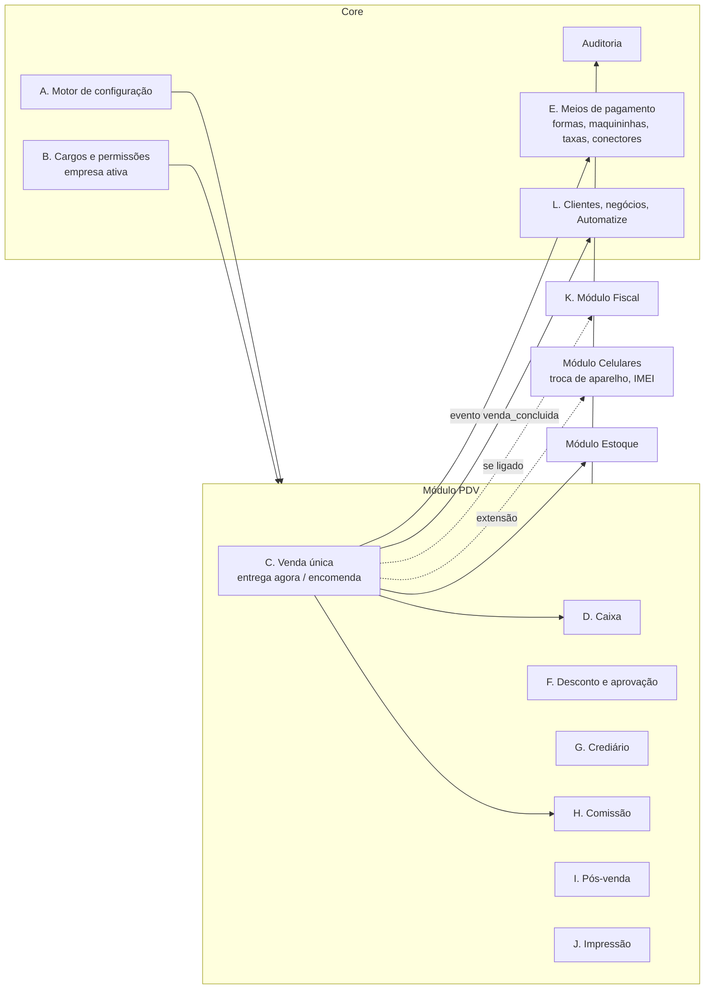
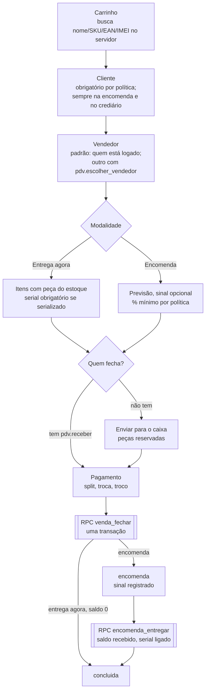
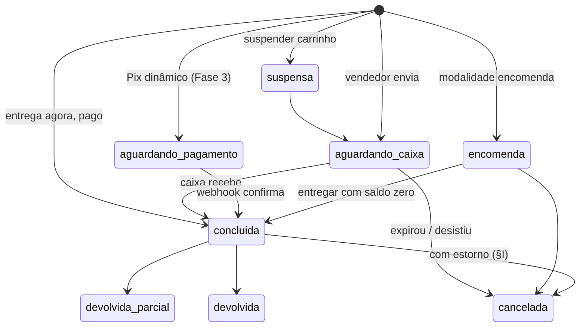

# PDV v2 — Especificação de arquitetura e plano de fases

**Data:** 19/11/2026 · **Tipo:** só documentação (nenhum código, migração ou dado alterado).
**Base:**
- [auditoria-pdv.md](auditoria-pdv.md): nota 2/10, 62 itens;
- hotfix da branch `fix/entregar-sem-pagamento` (`c21eca3a`, `e3cdf2cf`): `concluir_encomenda`, `concluir_venda_pdv`, `encomenda_saldo`, trava `vendas_conclusao_guarda`, colunas `concluida_em/por/via`;
- [reconciliacao-encomendas.md](reconciliacao-encomendas.md): 92 encomendas, R$ 596.705,50 sem registro;
- código de `main` (`d64607e5`) e catálogo de produção (só `SELECT`).

---

## 0. Como ler este documento

### 0.1 Os cinco princípios (fixos, vêm do pedido)

1. **Regra de negócio é configuração da empresa.** Tudo o que varia entre empresas ou lojas é preenchido pela empresa no Nexus: limites, taxas, nomes, formas de pagamento, maquininhas, comissão, desconto, juros, layouts e campos. O código garante só as **invariantes**, listadas em 0.2.
2. **O PDV é um módulo de comércio de produtos.** É ligado ou desligado por empresa. Veículos, imóveis e estética têm módulos próprios e **não usam o PDV**; não existe tipo "veículo" dentro dele. Desligar o PDV não pode quebrar nenhuma outra tela (§0.4).
3. **Um único fluxo de venda, sem abas.** No fechamento o operador escolhe **entrega agora** ou **encomenda** (sinal opcional, saldo na entrega). Toda conclusão passa por função no banco, atômica.
4. **Permissão no servidor.** RLS e funções conferem a permissão; a tela só esconde o que já está barrado. A empresa monta os cargos marcando permissões.
5. **Tudo auditado:** quem, quando, o quê, valor antes e depois.

### 0.2 Invariantes (o que o código garante, sem configuração que desligue)

| # | Invariante | Onde é garantida |
|---|---|---|
| I1 | Isolamento entre empresas e lojas | RLS + `get_empresa_id()` + `filiais_visiveis()` (já existem e estão corretos) |
| I2 | Venda, itens, pagamentos, estoque, caixa, comissão e auditoria gravam juntos ou nada grava | Uma transação por RPC `SECURITY DEFINER` |
| I3 | Venda não conclui com saldo em aberto | RPC + trigger de guarda (generaliza a `vendas_conclusao_guarda` do hotfix) |
| I4 | Total = Σ itens − descontos + acréscimos; pagamento a mais só em dinheiro e vira **troco registrado** | RPC |
| I5 | Toda mudança de estoque deixa uma linha no livro de movimentação | RPC (`estoque_movimentacoes`) |
| I6 | O navegador não escreve em tabela de dinheiro, estoque ou venda: só lê | RLS só de leitura + `revoke` de insert/update/delete |
| I7 | Escrita só com o módulo ligado | `modulo_ligado('pdv')` dentro de cada RPC (hoje a trava é só de tela) |
| I8 | Ação sensível exige a permissão e grava auditoria | `tem_permissao()` + `auditar()` dentro das RPCs |
| I9 | Lançamento de período fechado (caixa, comissão) não se altera: corrige-se com lançamento novo | Trigger que bloqueia update/delete + RPC de ajuste |
| I10 | Nada é inventado: pagamento sem comprovante não é criado (legado fica marcado) | Processo de migração (§M) |

### 0.3 Configuração × cadastro × código

| Tipo | Exemplo | Onde mora |
|---|---|---|
| **Política** (um valor) | "fechamento cego", "minutos de espera da aprovação", "% mínimo do sinal" | Motor de configuração (§A), chave → valor, por empresa ou loja |
| **Cadastro** (lista com linhas) | formas de pagamento, maquininhas, taxas, cargos, regras de desconto e comissão, layouts | Tabela própria, com tela de CRUD |
| **Invariante** | tabela 0.2 | Código e banco, sem chave de configuração |
| **Valor de fábrica** | formas padrão, cargos padrão, layout de cupom padrão | Semeado na instalação do módulo e **editável**; nada fica preso no código |

### 0.4 PDV desligável: o que depende dele hoje

Hoje **23 arquivos** fora do PDV leem `vendas_vendas`/`vendas_pagamentos`:
- `visao-geral`, `metas`, `ranking`, `relatorios`, `financeiro`, `garantia`, `os-modal`, `equipe-view`, `clientes/fundir-leads`;
- `configuracoes/usuarios`, `exportar`, `orcamento/[token]`, `compras/receber`, `superadmin/empresas`;
- ZapIntel: `conversa`, `perfil`, `lib/zapintel/ponte`;
- `lib/painel/metricas`, `lib/ranking`, `lib/fusao-contatos`, `lib/lgpd/exportacao`, `lib/assistente/ferramentas`, `lib/contrato-emitir`.

No banco, os triggers `tg_zapintel_vendas_ao_vivo` e `zapintel_posvenda` também leem.

Regra do v2:
- **O core não lê tabela do PDV direto.** Painel, Clientes, Ranking e Metas pedem "indicadores de venda" a um **provedor registrado pelo módulo** no manifesto (`core/modulos.ts`, nova capacidade `indicadoresDeVenda`). Com o PDV desligado, o provedor não existe e a tela esconde a coluna ou o card. Nada mostra zero como se fosse verdade.
- Módulo que precisa de venda declara `requer: ['pdv']` ou trata a ausência.
- **Correção já identificada:** `avaliacoes` (Avaliação de veículos) declara `requer: ['pdv']` ([core/modulos.ts:159](../core/modulos.ts:159)). Pelo princípio 2, isso sai: veículo vende pelo módulo Veículos.
- Teste fixo: smoke e2e de **todas** as telas com uma empresa sem o PDV (§Fases, "Como testar").

### 0.5 Visão geral



---

## A. Motor de configuração por empresa (e por loja)

### O que existe hoje

A configuração está espalhada:
- `empresas.permissoes` (jsonb);
- `configuracoes_sistema` (chave/valor por empresa, 5 chaves: roleta, SLA, saúde do WhatsApp, automações pausadas);
- `empresa_modulos.config` (só `forcado`);
- `empresa_menu.itens`;
- constantes no código. As formas de pagamento estão fixas em 3 lugares ([auditoria §2.2](auditoria-pdv.md)).

Não há uma regra única de "valor da loja → valor da empresa → padrão".

### Modelo de dados

**Definições no código, valores no banco.** Cada módulo declara suas chaves no manifesto (`core/modulos.ts`, novo campo `configuracoes`):

```ts
interface DefinicaoConfig {
  chave: string                 // 'caixa.fechamento_cego'
  tipo: 'booleano' | 'numero' | 'moeda' | 'percentual' | 'minutos' | 'opcao' | 'lista' | 'texto'
  padrao: unknown               // valor de fábrica
  escopo: 'empresa' | 'empresa_ou_loja'
  materializar?: boolean        // grava o padrão na instalação (para mudanças futuras do padrão não mudarem a empresa sem ela saber)
  opcoes?: { v: string; l: string }[]
  min?: number; max?: number
  secao: string                 // 'Caixa', 'Venda', ...
  rotulo: string; ajuda: string
  permissao?: string            // quem edita; padrão 'pdv.configurar'
}
```

| Tabela | Colunas | RLS |
|---|---|---|
| `empresa_config` (core, nova) | `empresa_id`, `filial_id` (nulo = empresa toda), `modulo`, `chave`, `valor jsonb`, `atualizado_por`, `atualizado_em`. Única em `(empresa_id, coalesce(filial_id,0), modulo, chave)` | SELECT: membro ativo da empresa. Escrita: **só RPC** |

**Funções:**
- `config_valor(p_modulo, p_chave, p_filial)`, em SQL `STABLE`, devolve `jsonb` nesta ordem: valor da loja, valor da empresa, `null`. O padrão vem do código: as RPCs recebem o padrão materializado ou usam `coalesce` com o padrão escrito na própria função, gerado do manifesto por script (como já se faz com os tipos).
- `config_salvar(p_modulo, p_chave, p_valor, p_filial)`, `SECURITY DEFINER`:
  - confere a permissão da definição;
  - valida tipo e faixa (min/max) pelas regras exportadas do manifesto;
  - grava auditoria com o valor antes e depois.
- `lib/config.ts`: `lerConfig(modulo, filialId)` resolve as camadas no servidor, com cache por request, e devolve o objeto tipado pelo manifesto.

**Cadastros** (formas, maquininhas, cargos, regras, layouts) ficam em tabelas próprias, descritas em cada bloco. O motor não vira um "banco dentro do banco".

**Padrões na criação:**
- O cadastro da empresa já copia o preset (`lib/presets.ts`), e a instalação de módulo já cria campos (`lib/modulos-instalacao.ts`). O PDV passa a semear também:
  - as formas de pagamento padrão;
  - os 5 cargos padrão;
  - os layouts de cupom e de etiqueta;
  - as chaves com `materializar: true`.
- Tudo editável. Reinstalar não sobrescreve o que a empresa mudou.

### Telas

- **Configurações → PDV**, com uma seção por bloco: Venda, Caixa, Pagamentos, Descontos, Crediário, Comissão, Pós-venda, Impressão e Fiscal (esta só aparece com o módulo Fiscal ligado).
- Cada campo mostra o rótulo, a ajuda e o selo "padrão" (quando não foi editado) ou "editado por X em dd/mm".
- Para chaves de `empresa_ou_loja`, aparece o seletor "Toda a empresa / Loja X". Na loja, o switch "usar valor próprio desta loja" e "voltar ao valor da empresa".

### O que muda no código atual

| Item | Ação |
|---|---|
| `abasConfiguracoes` no manifesto | **Reaproveitar**: a seção nasce do módulo, como hoje |
| `empresa_modulos.config` | **Manter** só para `forcado`; não guardar política ali |
| `configuracoes_sistema` | **Migrar depois** (fora do PDV) para `empresa_config`, módulo `core` |
| Listas fixas de formas, `descontoMax`, garantia padrão, tolerância de troca, comanda | **Descartar do código**: viram cadastro ou chave |

---

## B. Cargos e permissões

### O que existe hoje

- 4 papéis fixos (`owner`, `admin`, `vendedor`, `tecnico`) em `empresa_usuarios.role`.
- 7 permissões em `empresas.permissoes` ([lib/permissoes.ts](../lib/permissoes.ts)), lidas **só na tela**. `descontoMax` não é lido por ninguém.
- RLS `ALL` para qualquer membro em venda, pagamento e estoque ([auditoria H](auditoria-pdv.md)).
- `get_empresa_id()` faz `LIMIT 1` **sem ORDER BY** sobre os vínculos ativos. Hoje há 0 usuários com mais de um vínculo ativo, mas o resultado seria indeterminado.

### Modelo de dados

| Tabela | Colunas | RLS |
|---|---|---|
| `empresa_cargos` (core) | `id`, `empresa_id`, `nome`, `descricao`, `sistema bool` (Dono: não editável nem apagável), `criado_por/em` | SELECT membro; escrita só RPC (`equipe.cargos`) |
| `empresa_cargo_permissoes` (core) | `cargo_id`, `empresa_id`, `permissao text`, `limite numeric null`. PK `(cargo_id, permissao)` | idem |
| `empresa_usuarios` | **+ `cargo_id`** (FK). `role` fica: `owner` continua sendo "dono total"; os demais papéis viram o cargo semeado correspondente | já existe |
| `usuarios` | **+ `empresa_ativa_id`**, protegida pelo trigger `prevent_privilege_escalation` (só muda pela RPC) | já existe |

O catálogo de permissões fica no manifesto. Cada módulo declara as suas: chave, rótulo, tipo `sim/não` ou `limite` (% ou R$), grupo.

**Funções** (`SECURITY DEFINER`, `STABLE`, `search_path` fixo):
- `tem_permissao(p text) → boolean`: dono = sempre; senão, existe a linha no cargo do vínculo ativo em `get_empresa_id()`.
- `limite_permissao(p text) → numeric`: dono = sem limite (`null` = ∞); sem a permissão = 0.

São usadas nas políticas de **leitura** (ex.: ver venda de outro) e dentro de **todas** as RPCs de escrita.

### Catálogo inicial (PDV e afins) e cargos semeados

| Permissão | Tipo | Gerente | Vendedor | Caixa | Técnico |
|---|---|---|---|---|---|
| `pdv.vender` (montar venda, enviar ao caixa) | sim/não | ✓ | ✓ | ✓ | — |
| `pdv.escolher_vendedor` (vender em nome de outro) | sim/não | ✓ | — | ✓ | — |
| `pdv.receber` (registrar pagamento e concluir) | sim/não | ✓ | — ¹ | ✓ | — |
| `caixa.operar` (abrir o próprio caixa, sangria, suprimento, fechar) | sim/não | ✓ | — | ✓ | — |
| `caixa.ver_esperado` (fechamento não cego) | sim/não | ✓ | — | — | — |
| `caixa.reabrir` | sim/não | ✓ | — | — | — |
| `caixa.ver_todos` (caixas de outros) | sim/não | ✓ | — | — | — |
| `pdv.desconto` | limite % | 100 | 10 | 5 | 0 |
| `pdv.desconto_aprovar` (aprova pedidos até X%) | limite % | 100 | — | — | — |
| `pdv.vender_abaixo_custo` | sim/não | ✓ | — | — | — |
| `pdv.cancelar` | sim/não | ✓ | — ² | — ² | — |
| `pdv.devolver` / `pdv.trocar` | sim/não | ✓ | — | — | — |
| `crediario.liberar` | limite R$ | ∞ | — | — | — |
| `crediario.receber` | sim/não | ✓ | — | ✓ | — |
| `pdv.ver_custo` (custo e margem) | sim/não | ✓ | — | — | — |
| `comissao.ver_propria` / `comissao.ver_todas` | sim/não | ✓ / ✓ | ✓ / — | ✓ / — | ✓ / — |
| `comissao.fechar` | sim/não | — (Dono) | — | — | — |
| `pdv.lancar_retroativo` | sim/não | — (Dono) | — | — | — |
| `pdv.configurar`, `equipe.cargos` | sim/não | — (Dono) | — | — | — |
| `auditoria.ver` | sim/não | ✓ | — | — | — |
| core (hoje em `empresas.permissoes`): `core.ver_financeiro`, `core.ver_relatorios`, `core.ver_leads_outros`, `core.ver_vendas_outros`, `core.excluir`, `core.exportar` | sim/não | migradas com o valor que a empresa salvou | | | |

¹ A política `caixa.vendedor_pode_receber` (§D) pode liberar o vendedor sem caixa para receber formas não-dinheiro.
² A política `pdv.cancelar_propria_minutos` libera cancelar a **própria** venda em até N minutos (padrão 0 = desligado).

### Empresa ativa (corrige o achado da auditoria)

`get_empresa_id()` passa a resolver nesta ordem:
1. impersonação válida (como hoje);
2. `usuarios.empresa_ativa_id`, se o vínculo com ela estiver ativo;
3. o único vínculo ativo, quando houver só um;
4. senão, `null`. Com `null`, a RLS nega tudo e o app manda para **"Escolha a empresa"**.

- Troca de empresa: RPC `trocar_empresa_ativa(p_empresa)`, que confere o vínculo, audita e limpa `filial_atual_id`. Na tela, seletor no topo (ao lado do de loja), visível só para quem tem mais de um vínculo.
- O cache da trava de menu (`nx_mod`) e o cache de 1 min do proxy passam a ter a empresa na chave.
- Efeito em produção: nenhum, porque hoje ninguém tem dois vínculos ativos.
- Limitação aceita: a empresa ativa é **por usuário**, não por aba. Duas abas em empresas diferentes não funcionam ao mesmo tempo. Resolver por aba exigiria a empresa no JWT, fora do escopo.

### Telas

- **Configurações → Cargos:**
  - lista de cargos com quantas pessoas há em cada um;
  - editor de cargo com as permissões agrupadas por módulo (só os módulos ligados aparecem) e o campo de limite nas do tipo limite;
  - "duplicar cargo".
- **Equipe:** o cargo de cada pessoa (troca auditada).

### O que muda

| Item | Ação |
|---|---|
| `lib/permissoes.ts` (`permsDoPapel`) | **Refatorar**: vira leitura de `tem_permissao`/cargos; `PERM_DEFAULT` vira a semente dos cargos |
| `empresas.permissoes` | **Migrar** para as linhas de cargo e depois remover a coluna |
| Tela `configuracoes/(admin)/permissoes` | **Substituir** pela tela de Cargos |
| RLS `tenant_isolamento` ALL em vendas, pagamentos, estoque, comissões | **Descartar**: só SELECT (empresa + loja + `core.ver_vendas_outros` ou dono da linha); escrita só por RPC |
| `get_empresa_id()` | **Refatorar** (ordem acima) |

### Auditoria (transversal, entra na Fase 1)

| Tabela | Colunas | Regras |
|---|---|---|
| `auditoria_eventos` (core) | `id`, `empresa_id`, `filial_id`, `usuario_id`, `impersonado_por`, `entidade` ('venda', 'caixa', 'config', 'cargo', …), `entidade_id`, `acao`, `antes jsonb`, `depois jsonb`, `motivo`, `origem` (nome da RPC), `criado_em` | Só INSERT, e só pela função `auditar()` chamada de dentro das RPCs. UPDATE/DELETE revogados de todos os papéis, inclusive com trigger que bloqueia. SELECT com `auditoria.ver` |

- `vendas_alertas` (aceite de troca acima da referência) continua até a Fase 2. Depois é absorvida pela auditoria (`acao = 'troca_acima_referencia'`).
- Tela **Auditoria**: filtro por pessoa, entidade, ação e período, e o "antes → depois" lado a lado.

---

## C. Venda única

### Fluxo



- Some a divisão "Pronta Entrega / Encomenda / Reservas" em abas. Fica **uma tela de venda**, mais duas **filas**, que são listas e não fluxos de venda:
  - "Encomendas em aberto" (pedido feito, chegou, entregar);
  - "Aguardando caixa".
- A reserva de lead (hoje uma aba) vira um filtro da fila.

### Estados da venda



A etapa logística da encomenda (`aguardando_pedido`, `pedido_feito`, `chegou`) é a coluna `encomenda_etapa`, não um status de dinheiro.

### Modelo de dados

| Tabela | Colunas principais |
|---|---|
| `vendas` (cabeçalho, nova) | `id`, `empresa_id`, `filial_id`, `numero` (sequência por loja), `status` (CHECK com os estados acima), `modalidade` (`entrega_agora`/`encomenda`), `encomenda_etapa`, `previsao_entrega`, `cliente_id`, `vendedor_id`, `operador_id` (quem montou), `recebido_por`, `caixa_sessao_id`, `subtotal`, `desconto_total`, `desconto_aprovacao_id`, `acrescimo`, `total`, `troco`, `concluida_em/por/via`, `entregue_em/por`, `origem` (`pdv`, `orcamento`, `pre_venda`, `legado`), `origem_id`, `negocio_id`, `chave_idempotencia uuid unique`, `pendencia_legado numeric` (§M), `observacao`, `criado_em` |
| `vendas_itens` (nova) | `venda_id`, `produto_id`, `unidade_id`, `serial` (cópia do IMEI/série no momento), `descricao`, `quantidade`, `preco_tabela`, `preco_unit`, `desconto_valor`, `desconto_motivo`, `total`, `custo_unit` (cópia), `status` (`reservado`, `entregue`, `devolvido`, `cancelado`), `devolvido_qtd`, `observacao` |
| `vendas_participantes` (nova) | `venda_id`, `usuario_id`, `papel` (`vendedor`, `vendedor_auxiliar`, `operador`), `fracao`. Padrão: vendedor 100%. É a base da divisão de comissão (§H) |
| `vendas_pagamentos` (evolui) | `venda_id` → **`vendas`**, `forma_id`, `momento` (`sinal`, `entrega`, `balcao`), `valor` (o que abate a venda), `valor_recebido` (dinheiro), `troco`, `parcelas`, `bandeira`, `nsu`, `autorizacao`, `maquininha_id`, `taxa_lojista_valor`, `taxa_cliente_valor`, `status` (`confirmado`, `aguardando`, `estornado`), `confirmado_por`, `caixa_sessao_id`, `troca_unidade_id`, `credito_id`, `cobranca_id`, `natureza` (`normal`, `retroativo_reconciliacao`, `legado`), `recebido_por`, `criado_em` |
| `estoque_unidades` | + `reservado_venda_id`, `reservado_ate`. O status `reservado` já existe |
| `estoque_produtos` | + `serializado bool` (padrão vindo da categoria: `estoque_categorias.serializado`), `sku`, `ean text[]` |
| `estoque_movimentacoes` | Passa a receber toda entrada, venda, troca, devolução e ajuste (`origem_tipo`, `origem_id`, `usuario_id`) |

### Regras que o v2 traz e onde ficam

| Regra | Invariante ou configuração |
|---|---|
| Produto serializado exige peça com serial na entrega (na encomenda, só na entrega) | Invariante. *Qual* produto é serializado é cadastro (categoria/produto) |
| **Aparelho na troca é forma de pagamento** e entra no estoque **na mesma transação** (corrige a pendência do hotfix) | Invariante: a RPC cria a `estoque_unidades` (`tipo='troca'`), marca a cotação `usada_em`, grava a movimentação de entrada, o pagamento `troca` e o termo. Se algo falhar, nada fica |
| Status da peça de troca ao entrar (`disponivel` ou `em_revisao`) | Política `venda.troca_entra_como` |
| Pagamento a mais só em forma que aceita troco (`pagamento_formas.aceita_troco`) | Invariante. O troco é gravado (`vendas_pagamentos.troco` e `caixa_movimentos` tipo `troco`). Sobra em forma sem troco é recusada, ou vira vale-troca na Fase 2 se `venda.sobra_vira_credito` |
| Cliente obrigatório | Política `venda.cliente_obrigatorio` (`nunca`, `acima_de_valor`, `sempre`); sempre na encomenda e no crediário (invariante) |
| Sinal mínimo da encomenda | Política `encomenda.sinal_minimo_pct` (padrão 0) |
| Reserva de quem envia ao caixa expira | Política `venda.reserva_caixa_minutos` (padrão 60) |
| Venda exige caixa aberto | Política `caixa.exige_caixa_aberto` (§D) |
| Preço abaixo do catálogo / do custo | Aviso de catálogo: reaproveita `lib/valor-abaixo-do-catalogo.ts`. Abaixo do custo exige `pdv.vender_abaixo_custo` ou aprovação (§F) |
| Duplo clique / rede caindo | `chave_idempotencia`: a segunda chamada devolve a venda já criada |

**A troca é extensão do módulo Celulares.**
- A RPC do núcleo aceita uma troca **genérica**: `{produto_id?, descricao, serial?, atributos jsonb, valor, cotacao_id?}`.
- O módulo Celulares fornece a tela de avaliação (IMEI, bateria, checklist, cotação) e os atributos.
- Sem Celulares ligado, a troca vira um formulário simples (descrição, serial, valor), ou é desligada pela política `venda.aceita_troca`.

### Funções no banco (todas `SECURITY DEFINER`, `search_path` fixo, `modulo_ligado('pdv')`, auditadas)

| RPC | Faz | Evolui de |
|---|---|---|
| `venda_fechar(p jsonb)` | Cria venda, itens, participantes e pagamentos. Baixa ou reserva estoque, entra a troca, valida desconto (§F), caixa (§D), troco e idempotência. Conclui se for entrega agora com saldo 0; deixa em `encomenda` com o sinal; ou deixa em `aguardando_caixa` | `concluir_venda_pdv` (hotfix) + o `finalizarVenda` do navegador |
| `venda_receber(p_venda, p_pagamentos)` | O caixa recebe uma venda `aguardando_caixa` e conclui | novo |
| `encomenda_atualizar(p_venda, p_etapa, p_unidades)` | Pedido feito, chegou, liga a peça | `/api/compras/receber` + ajustes da aba Encomenda |
| `encomenda_entregar(p_venda, p_pagamentos, p_unidades)` | Recebe o saldo e conclui | `concluir_encomenda` (hotfix), quase igual |
| `venda_suspender` / `venda_retomar` | Carrinho salvo no servidor (`status = suspensa`) | novo |
| `venda_saldo(p_venda)` | Total, pago, saldo e troco para a tela | `encomenda_saldo` (hotfix) |

### Telas

- **PDV (uma tela):**
  - busca;
  - carrinho com desconto por item e no total (R$ e %);
  - cliente com resumo (compras, crediário em aberto, vale);
  - vendedor;
  - alternância **Entrega agora / Encomenda**;
  - painel de pagamento (as formas da empresa, troca, troco);
  - botão "Finalizar" ou "Enviar para o caixa", conforme a permissão.
  - Atalhos de teclado e leitor de código com Enter.
- **Filas:** Aguardando caixa · Encomendas em aberto (etapas) · Suspensas.
- **Histórico:**
  - lista e 2ª via;
  - "Entregar" abre o mesmo painel de pagamento (já é assim no hotfix);
  - ações de pós-venda (§I).

### O que muda

| Item | Ação |
|---|---|
| `concluir_encomenda`, `concluir_venda_pdv`, `encomenda_saldo`, guarda, `concluida_*` (hotfix) | **Reaproveitar** como base das RPCs |
| `pdv-view.tsx` (1.434 linhas) | **Refatorar**: quebrar em busca, carrinho, cliente, pagamento e fila; o fechamento sai do navegador |
| `encomenda-form.tsx` (pagamento e cliente próprios) | **Descartar**: a encomenda é a mesma tela com a modalidade "Encomenda" |
| `encomenda-fechar.tsx` | **Reaproveitar** como o painel de pagamento único (já usado pelo Histórico no hotfix) |
| `encomendas-abertas.tsx` | **Reaproveitar** como a fila de encomendas |
| `lib/pdv-pagamentos.ts` (parcelas, juros, `faltaParaFechar`) | **Reaproveitar** |
| Desfazer no navegador, 3 listas de formas, 3 seletores de cliente | **Descartar** (fica o `cliente-autocomplete` com busca no servidor) |
| `/api/orcamento/[token]` (cria venda com service_role) | **Refatorar**: chama `venda_fechar` como encomenda/pendente, com `origem = 'orcamento'` |
| `vendas_vendas` | **Migrar** para `vendas` + `vendas_itens` (§M) |

---

## D. Caixa como permissão

Não há limite de caixas: quem tem `caixa.operar` abre **o seu**, com fundo de troco. "Terminal" é só um rótulo livre e opcional ("Balcão 1").

### Modelo de dados

| Tabela | Colunas | Regras |
|---|---|---|
| `caixa_sessoes` | `id`, `empresa_id`, `filial_id`, `operador_id`, `rotulo`, `status` (`aberto`, `fechado`), `aberto_em`, `fundo_troco`, `fechado_em/por`, `esperado jsonb` (por forma), `informado jsonb` (por forma), `diferenca jsonb`, `observacao_fechamento`, `reaberto_em/por/motivo`, `vezes_reaberto` | Índice único parcial: **um caixa aberto por operador por loja**. Leitura: o próprio, ou `caixa.ver_todos` |
| `caixa_movimentos` | `id`, `sessao_id`, `tipo` (`abertura`, `venda`, `recebimento_parcela`, `sangria`, `suprimento`, `troco`, `estorno`, `ajuste_fechamento`), `forma_id`, `valor` (com sinal), `motivo`, `venda_id`, `pagamento_id`, `usuario_id`, `criado_em` | **Imutável**: só INSERT pela RPC; trigger bloqueia UPDATE/DELETE. Correção = lançamento novo |

**Esperado por forma** = fundo (só dinheiro) + Σ movimentos da forma. A conferência física é do dinheiro; cartão e Pix aparecem no relatório para bater com a maquininha e o extrato.

### Políticas configuráveis (chaves `caixa.*`, por empresa ou loja)

| Chave | Padrão sugerido |
|---|---|
| `caixa.fechamento_cego` | ligado (quem não tem `caixa.ver_esperado` informa os valores sem ver o esperado) |
| `caixa.exige_caixa_aberto` | ligado para receber dinheiro; para as outras formas, segue `caixa.vendedor_pode_receber` |
| `caixa.vendedor_pode_receber` | desligado. Ligado, quem vende sem caixa pode registrar as formas listadas em `caixa.formas_sem_caixa` (ex.: Pix, cartão); o pagamento fica sem `caixa_sessao_id` e aparece no relatório da loja como "recebido fora do caixa" |
| `caixa.sangria_motivo_obrigatorio` | ligado |
| `caixa.alerta_dinheiro_acima` | R$ 2.000 (sugere sangria) |
| `caixa.diferenca_tolerada` | R$ 0,00. Acima disso, o fechamento exige justificativa |
| Quem reabre | é a permissão `caixa.reabrir` (§B) |

### Funções

`caixa_abrir(p_fundo, p_rotulo)` · `caixa_movimentar(p_tipo, p_forma, p_valor, p_motivo)` · `caixa_fechar(p_informado jsonb, p_obs)` · `caixa_reabrir(p_sessao, p_motivo)` · `caixa_resumo(p_sessao)` (relatório).

- `venda_fechar`, `venda_receber`, `encomenda_entregar` e `crediario_receber` gravam o `caixa_movimentos` da venda **na mesma transação**.
- Reabrir não apaga o fechamento: grava auditoria e, no novo fechamento, a diferença nova.

### Telas

- **Barra do caixa** no PDV: "Caixa de Ana · aberto 09:02 · dinheiro R$ 812,00", com os botões Sangria, Suprimento e Fechar.
- **Abrir caixa:** fundo de troco.
- **Fechar:** um campo por forma. Cego ou com o esperado, conforme a permissão.
- **Relatório de fechamento** (80 mm e A4):
  - por forma: esperado, informado e diferença;
  - sangrias e suprimentos com motivo;
  - vendas, estornos, recebimentos de crediário;
  - quem abriu e quem fechou.
- **Histórico de caixas** por loja e por pessoa.

### O que muda

Não existe nada hoje ([auditoria C](auditoria-pdv.md)): é tudo novo. `financeiro_lancamentos` continua sendo o financeiro da empresa. O fechamento de caixa pode, por política (`caixa.gera_lancamento_financeiro`), gerar um lançamento consolidado por forma, sem duplicar venda por venda.

---

## E. Formas de pagamento e maquininhas

**Onde mora:** "Meios de pagamento" já é uma seção compartilhada por PDV, Assistência e Financeiro ([core/modulos.ts:243](../core/modulos.ts:243)). Para desligar o PDV sem quebrar a Assistência, as tabelas ficam no **core**, com o prefixo `pagamento_`. Decisão pendente nº 1.

### Modelo de dados

| Tabela | Colunas |
|---|---|
| `pagamento_formas` | `id`, `empresa_id`, `nome` ("Pix da loja", "Crédito Stone"), `tipo` (CHECK: `dinheiro`, `pix`, `debito`, `credito`, `link`, `crediario`, `vale`, `troca`, `boleto`, `outro`), `ativo`, `ordem`, `filiais bigint[]` (nulo = todas), `aceita_troco`, `exige_cliente`, `exige_nsu`, `permite_parcelas`, `max_parcelas`, `maquininha_id` padrão, `conta_destino` (texto: "Itaú ag/cc", "chave Pix"), `pix_chave` (para o estático), `conector` (`manual` padrão; `pagbank`, … na Fase 3), `prazo_recebimento_dias` |
| `pagamento_maquininhas` | `id`, `empresa_id`, `filial_id` (nulo = rede), `nome`, `adquirente` (texto livre), `identificador` (série/terminal), `conector`, `ativo` |
| `pagamento_taxas` | `id`, `empresa_id`, `forma_id` ou `maquininha_id`, `bandeira` (nulo = todas), `parcelas_de`, `parcelas_ate`, `taxa_lojista_pct` (MDR, custo da loja), `taxa_cliente_pct` (juros repassados), `prazo_dias` |
| `pagamento_conectores` | É a `financeiro_config_pagamento` de hoje (provider, `credenciais_cipher`, modo), **reaproveitada** com renomeação |

O registro manual é o padrão:
- o operador escolhe a forma, a bandeira e as parcelas e digita o NSU, se `exige_nsu`;
- a taxa do lojista vira **custo** da venda (`taxa_lojista_valor`) e entra na margem e na comissão sobre margem;
- os juros repassados ao cliente entram em `taxa_cliente_valor`.

### Conectores (arquitetura)

`lib/payments` já tem um contrato agnóstico (`types.ts`) e 5 provedores (`manual`, `mercadopago`, `asaas`, `efibank`, `pagseguro`) para **cobrança** (Pix, boleto, link). O v2 estende esse contrato:

```ts
interface ConectorPagamento {
  id: 'manual' | 'pagbank' | 'mercadopago' | 'stone' | ...
  capacidades: { pixDinamico?: boolean; cobrancaPresencial?: boolean; estorno?: boolean; consulta?: boolean }
  criarCobranca(input): Promise<CobrancaResult>            // Pix dinâmico, link (existe)
  cobrarNaMaquininha?(input): Promise<{ ref: string }>     // POS integrado (Fase 3)
  consultar?(ref): Promise<StatusCobranca>
  estornar?(ref, valor): Promise<void>
  tratarWebhook(req): Promise<EventoPagamento>             // idempotente (existe)
}
```

- O pagamento nasce `aguardando`. O webhook chama `pagamento_confirmar(pagamento_id, ref)`, que é interna (service_role) e idempotente, e **confirma a venda** (hoje o webhook só mexe em `financeiro_cobrancas`).
- **Ordem:** PagBank primeiro (o `pagseguro.ts` atual é a base para o Pix; o POS depende da API do PagBank para maquininha, a confirmar na Fase 3), depois os outros.
- **Pix estático (Fase 1):**
  - a forma tem `pix_chave`;
  - o PDV gera o QR "copia e cola" com o valor (BR Code estático, gerado no navegador, sem gateway);
  - o operador confirma "recebido" (fica `confirmado_por`), com o comprovante opcional anexado.
- **Pix dinâmico (Fase 3):** pelo conector; a venda fica `aguardando_pagamento` até o webhook. O tempo limite é a política `pagamento.pix_espera_minutos`.

### Telas

Configurações → Pagamentos:
- **Formas:** lista arrastável com ativo/inativo e editor.
- **Maquininhas:** cadastro e a grade de taxas por bandeira × parcelas, com "copiar de outra maquininha".
- **Conectores:** credenciais (dono, cofre já existente) e "testar conexão".

### O que muda

| Item | Ação |
|---|---|
| 3 listas fixas de formas | **Descartar**; as formas padrão são semeadas: Dinheiro, Pix, Débito, Crédito, Link, Troca |
| `financeiro_taxas` (forma × bandeira × parcelas × %) | **Migrar** para `pagamento_taxas`, com a separação lojista × cliente; leitores atuais: PDV, simulador de parcela, Assistência |
| `financeiro_config_pagamento` + `lib/payments` | **Reaproveitar** e estender |
| `/api/payments/webhook` | **Refatorar**: além da cobrança, chama `pagamento_confirmar` |

---

## F. Descontos e aprovação remota

### Modelo de dados

| Tabela | Colunas |
|---|---|
| `desconto_regras` (PDV) | `id`, `empresa_id`, `filial_id` (nulo = todas), `escopo` (`geral`, `categoria`, `produto`, `condicao`), `alvo` (id ou valor), `cargo_id` (nulo = todos), `limite_pct`, `limite_valor`, `piso` (`custo`, `custo_mais_pct`, nenhum), `piso_pct`, `motivo_obrigatorio`, `ativo` |
| `desconto_aprovacoes` (PDV) | `id`, `empresa_id`, `filial_id`, `solicitante_id`, `carrinho_hash` (itens + preços + desconto), `resumo jsonb` (o que o aprovador vê), `desconto_pct`, `desconto_valor`, `motivo`, `status` (`pendente`, `aprovada`, `recusada`, `expirada`, `usada`), `aprovador_id`, `canal` (`nexus`, `whatsapp`, `email`, `pin`), `token_hash`, `expira_em`, `decidido_em`, `usada_em_venda_id` |
| `usuarios_pin` (core) | `usuario_id`, `pin_hash` (pgcrypto `crypt`), `tentativas`, `bloqueado_ate` |

**Limite efetivo** = o menor entre:
- o limite do cargo (`pdv.desconto`);
- a regra mais específica que se aplica, na ordem produto > categoria > condição > geral (com cargo antes de sem cargo);
- o piso de custo.

Acima dele, o operador pede aprovação.

### Fluxo de aprovação

1. O operador pede, com motivo, e nasce a `desconto_aprovacoes` pendente.
2. O aviso vai para quem tem `pdv.desconto_aprovar` ≥ o % pedido, na loja, pelos canais da política `desconto.canais`:
   - **Nexus:** notificação e push (`lib/push.ts`);
   - **WhatsApp:** mensagem pelo número da empresa (`lib/whatsapp`) para o celular do aprovador, com um link de uso único;
   - **e-mail** (`lib/email.ts`), com o mesmo link;
   - **PIN no balcão:** o aprovador digita o PIN no aparelho do operador. Depois de 5 erros, bloqueia por 15 minutos.
3. O link abre `/aprovar/<token>`, que **exige o aprovador logado** (recomendado; decisão pendente nº 5). Mostra o carrinho, o desconto, a margem resultante e o motivo, com os botões Aprovar e Recusar.
4. O PDV acompanha o pedido por consulta a cada 3 s (sem realtime: evita voltar a tabela à publicação do WAL). Expira em `desconto.espera_minutos` (padrão 10).
5. `venda_fechar` recebe o `desconto_aprovacao_id` e confere:
   - status `aprovada`;
   - mesmo `carrinho_hash`;
   - não expirada;
   - não usada.

   Em seguida marca `usada` e grava `desconto_aprovado_por`. Mudou o carrinho, a aprovação não vale mais.

Tudo é auditado: pedido, aprovação ou recusa, canal e o uso na venda.

### Telas

- Configurações → Descontos: as regras e as políticas (canais, espera, motivo obrigatório, piso).
- Equipe: "Definir meu PIN".
- PDV: o aviso "acima do seu limite (10%) · pedir aprovação" e o cartão de espera com contagem.
- Notificações: a fila de pedidos do aprovador.

### O que muda

`descontoMax` ([lib/permissoes.ts](../lib/permissoes.ts)) vira o limite do cargo. `desconto_motivo` e `desconto_aprovado_por`, nunca preenchidos, passam a ser gravados pela RPC.

---

## G. Crediário / fiado

### Modelo de dados (PDV, prefixo `crediario_`)

| Tabela | Colunas |
|---|---|
| `crediario_clientes` | `contato_id`, `empresa_id`, `limite`, `bloqueado`, `motivo_bloqueio`, `atualizado_por/em` |
| `crediario_contratos` | `id`, `venda_id`, `contato_id`, `valor_financiado`, `entrada`, `n_parcelas`, `juros_pct_mes`, `sistema` (`simples`, `price`), `multa_pct`, `mora_pct_dia`, `primeiro_vencimento`, `status` (`ativo`, `quitado`, `cancelado`, `renegociado`), `liberado_por` |
| `crediario_parcelas` | `contrato_id`, `numero`, `vencimento`, `valor`, `valor_pago`, `status` (`aberta`, `paga`, `parcial`, `cancelada`), `pago_em` |
| `crediario_recebimentos` | `parcela_id`, `valor_principal`, `juros`, `multa`, `desconto`, `pagamento` (forma, valor, troco), `caixa_sessao_id`, `recebido_por`, `criado_em` (imutável) |

### Regras

- **Políticas `crediario.*`:**
  - juros ao mês;
  - sistema (simples ou Price);
  - multa e mora;
  - carência;
  - máximo de parcelas;
  - intervalo (30 dias ou dia fixo);
  - entrada mínima (%);
  - bloquear quem tem parcela atrasada há mais de N dias;
  - cadastro exigido (CPF, endereço);
  - arredondamento.
- **Atenção legal:** o CDC (art. 52, §1º) limita a multa de mora a 2% nas vendas a consumidor. A tela avisa se a empresa configurar mais que isso. Ser aviso ou trava é a decisão pendente nº 8.
- **Na venda:** forma de tipo `crediario`. `venda_fechar` confere:
  - limite disponível (limite − saldo devedor);
  - bloqueio;
  - `crediario.liberar` ≥ valor financiado.

  Depois cria o contrato e as parcelas na mesma transação.
- **Recebimento de parcela:** `crediario_receber(p_parcelas, p_pagamentos)` calcula juros e multa na data, grava o recebimento e o `caixa_movimentos` (`recebimento_parcela`), e entra no caixa do dia.

### Telas

- **No PDV**, ao escolher o cliente: "Crediário: R$ 1.200,00 em aberto · R$ 300,00 atrasado · limite livre R$ 800,00".
- **Cliente → aba Crediário:** extrato, parcelas, receber e 2ª via do carnê (PDF A4).
- **Crediário → painel:** a vencer, atrasados (com o botão de cobrança por WhatsApp em modelo editável) e recebidos por período.

### O que muda

Não existe nada hoje. É tudo novo. Boleto e carnê registrado vêm por conector na Fase 3.

---

## H. Comissão

### O que existe hoje

- Comissão **mensal** = `metas_comissoes.percentual_comissao_padrao` × a soma das vendas do vendedor ([equipe-view.tsx:468](../components/modules/equipe/equipe-view.tsx:468)).
- "Quitar" grava em `vendas_comissoes` sem `venda_id` (0 linhas em produção).
- `vendas_vendas.comissao` não é usado.
- Não há regra por produto, faixa ou condição.

### Requisitos (do complemento) e como o motor atende cada um

| # | Requisito | Onde fica no modelo |
|---|---|---|
| 1 | Escopo por categoria, condição (novo/seminovo) e outros filtros | `comissao_regras.filtro jsonb`: `categorias`, `condicoes`, `produtos`, `marcas`, `filiais`, `cargos`, `usuarios` |
| 2 | Métrica da faixa: quantidade ou valor; período configurável | `regra.metrica_faixa` (`quantidade`, `valor`); `plano.periodo` (`mes`, `semana`, `quinzena`, `intervalo`) + `dia_inicio` |
| 3 | Faixa atingida vale para tudo **ou** escalonado | `regra.modo_faixa` (`atingida`, `escalonado`) |
| 4 | Zero abaixo da 1ª faixa ou mínimo configurável | `regra.abaixo_primeira_faixa` (`zero`, `percentual`, `valor_fixo`) + `valor` |
| 5 | Condições da venda mudam o %: com/sem troca, forma de pagamento, desconto > X% | `comissao_variantes` (por faixa): `condicao jsonb` (`tem_troca`, `formas_tipo`, `desconto_pct_maior_que`) → `valor` que substitui o da faixa; a primeira que casa, pela prioridade |
| 6 | Base: bruto, líquido de desconto, líquido da troca (ou margem) | `regra.base` (`bruto`, `liquido_desconto`, `liquido_troca`, `margem`). A troca é pagamento da venda inteira e é rateada entre os itens na proporção do valor |
| 7 | Vendas com troca contam na quantidade da faixa? | `regra.troca_conta_na_faixa bool` |
| 8 | Quando conta e estorno em cancelamento/devolução, inclusive em mês fechado | `plano.momento` (`concluida`, `quitada`, `proporcional_recebido` para crediário). O estorno é automático; em período fechado, o ajuste vai para o período aberto (abaixo) |
| 9 | Percentual ou valor fixo por unidade; divisão entre pessoas | `regra.tipo_valor` (`percentual`, `fixo_unidade`); divisão por `vendas_participantes` (fração por venda) ou `regra.divisao jsonb` (ex.: vendedor 80% / operador 20%) |
| 10 | Prévia em tempo real, fechamento travado, relatório exportável | `comissao_previa()` sem gravar; `comissao_fechar()` materializa e trava; exportação CSV/PDF |

### Modelo de dados (PDV, prefixo `comissao_`)

| Tabela | Colunas |
|---|---|
| `comissao_planos` | `id`, `empresa_id`, `nome`, `periodo`, `dia_inicio`, `momento`, `vigencia_de/ate`, `ativo` |
| `comissao_regras` | `id`, `plano_id`, `nome`, `prioridade`, `filtro jsonb`, `metrica_faixa`, `modo_faixa`, `contagem` (`regra`: conta só os itens desta regra; `plano`: conta tudo do plano), `troca_conta_na_faixa`, `base`, `tipo_valor`, `abaixo_primeira_faixa`, `abaixo_valor`, `divisao jsonb`, `ativo` |
| `comissao_faixas` | `id`, `regra_id`, `de`, `ate` (nulo = sem teto), `valor` (% ou R$ por unidade) |
| `comissao_variantes` | `id`, `faixa_id`, `prioridade`, `condicao jsonb`, `valor` |
| `comissao_periodos` | `id`, `empresa_id`, `plano_id`, `inicio`, `fim`, `status` (`aberto`, `fechado`), `fechado_por/em` |
| `comissao_lancamentos` | `id`, `periodo_id`, `usuario_id`, `venda_id`, `venda_item_id`, `regra_id`, `faixa_id`, `variante_id`, `posicao` (nº da unidade no período, no escalonado), `base`, `valor_aplicado`, `comissao`, `tipo` (`credito`, `estorno`, `ajuste`), `referencia_periodo_id`, `criado_em`. **Imutável** depois do fechamento |
| `comissao_pagamentos` | `periodo_id`, `usuario_id`, `valor`, `pago_em`, `pago_por`, `observacao` |
| `equipe_remuneracao` (core/Equipe) | `usuario_id`, `empresa_id`, `salario`, `ajuda_custo`, `outros jsonb`, `vigencia_de`. **Só para o relatório de remuneração total**; não entra no cálculo do PDV |

### Cálculo

- **Prévia (período aberto):** `comissao_previa(p_periodo, p_usuario)` calcula na hora, sem gravar. Lê as vendas que contam pelo `momento`, aplica os filtros, ordena por `concluida_em` (empate: id do item), conta e aplica a faixa.
- **Faixa atingida:** a contagem (ou soma) final do período escolhe a faixa, e o % dela vale para **todas** as vendas da regra. Durante o mês, a prévia mostra a faixa provisória.
- **Escalonado por quantidade:** a n-ésima unidade do período recebe o % da faixa que contém n.
- **Escalonado por valor:** o valor acumulado é fatiado nas faixas, e uma venda que cruza a fronteira é dividida entre as duas.
- **Fechamento:** `comissao_fechar(p_periodo)` (permissão `comissao.fechar`) grava os `comissao_lancamentos` e trava. Daí em diante o período não muda.
- **Estorno (cancelamento ou devolução):**
  - **período aberto:** some sozinho da prévia;
  - **período fechado:** a RPC de cancelamento/devolução chama `comissao_ajustar(p_venda)`. Ela recalcula o período fechado **sem** a venda e lança a diferença (novo − original) como `ajuste` negativo no **período aberto**, com `referencia_periodo_id`. Se a devolução derrubar a faixa, a diferença inteira (de todas as vendas) entra no ajuste.

### Caso de validação: tabela da JM como dados

Nada disto está no código. É o que a JM preenche (ou o que semeamos para ela, editável):

```jsonc
// comissao_planos
{ "nome": "Vendedores JM", "periodo": "mes", "dia_inicio": 1, "momento": "concluida" }

// comissao_regras[0] + faixas + variantes
{ "nome": "Aparelhos novos", "prioridade": 10,
  // categorias gravadas por id; os nomes são os do cadastro da JM, sem o emoji
  "filtro": { "categorias": ["Iphone / Smartphone", "Ipad / Tablet", "MacBook / Notebook", "Apple Watch / Smartwatch"],
              "condicoes": ["novo"] },
  "metrica_faixa": "quantidade", "contagem": "regra", "modo_faixa": "atingida",   // ou "escalonado" (decisão)
  "troca_conta_na_faixa": true, "base": "liquido_desconto", "tipo_valor": "percentual",
  "abaixo_primeira_faixa": "zero", "divisao": [{ "papel": "vendedor", "fracao": 1 }],
  "faixas": [
    { "de": 10, "ate": 20,   "valor": 0.65, "variantes": [{ "condicao": { "tem_troca": true }, "valor": 0.45 }] },
    { "de": 21, "ate": 30,   "valor": 0.80, "variantes": [{ "condicao": { "tem_troca": true }, "valor": 0.60 }] },
    { "de": 31, "ate": null, "valor": 1.00, "variantes": [{ "condicao": { "tem_troca": true }, "valor": 0.80 }] } ] }

// comissao_regras[1]
{ "nome": "Seminovos", "prioridade": 20,
  "filtro": { "categorias": ["(as mesmas)"], "condicoes": ["seminovo", "usado"] },
  "metrica_faixa": "quantidade", "contagem": "regra", "modo_faixa": "atingida",
  "troca_conta_na_faixa": true, "base": "liquido_desconto", "tipo_valor": "percentual",
  "abaixo_primeira_faixa": "zero",
  "faixas": [ { "de": 3, "ate": 10, "valor": 1.00 }, { "de": 11, "ate": null, "valor": 1.20 } ] }

// equipe_remuneracao (por vendedor)
{ "salario": 1700.00, "ajuda_custo": 100.00 }
```

Acessórios, perfumes e "outros" não casam com nenhuma regra, então não geram comissão. É assim que a tabela da JM está escrita; se isso mudar, é outra regra, sem código.

### Exemplo calculado (vendedor fictício, novembro)

As premissas abaixo são decisões pendentes (nº 6):
- base = valor do item líquido de desconto, **sem** abater a troca (a troca já reduz o %);
- vendas com troca **contam** na faixa;
- a venda conta quando é concluída.

**Aparelhos novos: 25 unidades no mês**, em ordem de conclusão:

| Unidades | Sem troca | Com troca |
|---|---|---|
| 1 a 9 | 6 × R$ 5.000 = R$ 30.000 | 3 × R$ 7.000 = R$ 21.000 |
| 10 a 20 | 7 × R$ 6.000 = R$ 42.000 | 4 × R$ 8.000 = R$ 32.000 |
| 21 a 25 | 3 × R$ 6.500 = R$ 19.500 | 2 × R$ 9.000 = R$ 18.000 |
| **Total (25)** | **16 · R$ 91.500** | **9 · R$ 71.000** |

**Seminovos: 12 unidades no mês**: as unidades 1–2 a R$ 2.000 (R$ 4.000), 3–10 a R$ 2.500 (R$ 20.000) e 11–12 a R$ 3.000 (R$ 6.000). Total R$ 30.000.

| Cálculo | Modo 1: faixa atingida vale para todas | Modo 2: escalonado |
|---|---|---|
| Novos | 25 un. → faixa 21–30 para todas:<br/>R$ 91.500 × 0,80% = R$ 732,00<br/>R$ 71.000 × 0,60% = R$ 426,00<br/>**= R$ 1.158,00** | Unidades 1–9: abaixo da 1ª faixa = R$ 0,00<br/>10–20: R$ 42.000 × 0,65% + R$ 32.000 × 0,45% = R$ 273,00 + R$ 144,00 = R$ 417,00<br/>21–25: R$ 19.500 × 0,80% + R$ 18.000 × 0,60% = R$ 156,00 + R$ 108,00 = R$ 264,00<br/>**= R$ 681,00** |
| Seminovos | 12 un. → faixa 11+ para todas:<br/>R$ 30.000 × 1,2%<br/>**= R$ 360,00** | 1–2: R$ 0,00<br/>3–10: R$ 20.000 × 1% = R$ 200,00<br/>11–12: R$ 6.000 × 1,2% = R$ 72,00<br/>**= R$ 272,00** |
| **Comissão do mês** | **R$ 1.518,00** | **R$ 953,00** |
| + salário R$ 1.700 + ajuda R$ 100 | **R$ 3.318,00** | **R$ 2.753,00** |

O que muda entre os dois:
- no modo 1, ao bater uma faixa, as unidades anteriores (inclusive as 9 abaixo da 1ª faixa) passam a valer o % novo;
- no escalonado, cada unidade fica com o % da faixa em que caiu.

Para a mesma venda, a diferença aqui é de R$ 565,00 (37% a menos no escalonado).

**Variações para comparar:**
- *Troca não conta na faixa* (modo 1): contam só as 16 sem troca. A faixa cai para 10–20: R$ 91.500 × 0,65% + R$ 71.000 × 0,45% = R$ 594,75 + R$ 319,50 = **R$ 914,25** nos novos, em vez de R$ 1.158,00.
- *Prévia do vendedor* (modo 1, em 30/11): "Novos: 25 · faixa 21–30 · faltam **6** para a faixa 31+". Se chegar a 31, as 25 já vendidas passam de R$ 1.158,00 para R$ 915,00 + R$ 568,00 = **R$ 1.483,00** (+R$ 325,00), fora a comissão das 6 novas. "Seminovos: 12 · faixa máxima".
- *Estorno em mês fechado:*
  - em dezembro, a unidade nº 25 (com troca, R$ 9.000) é devolvida. Recalculado, novembro fica com 24 unidades, ainda na faixa 21–30, e o ajuste é −R$ 9.000 × 0,60% = **−R$ 54,00**, lançado em dezembro. No escalonado, como era a última unidade, também −R$ 54,00;
  - se a devolução tirasse uma unidade do começo do mês, todas as seguintes desceriam uma posição, e o recálculo pegaria isso;
  - se derrubasse a faixa no modo 1 (ex.: de 21 para 20), todas as vendas do mês seriam refeitas na faixa 10–20, e a diferença inteira iria para dezembro.

### Telas

- **Configurações → Comissão:**
  - planos e regras (filtros, faixas, variantes) com **simulador**: "se eu vender X, quanto ganho";
  - pré-visualização das vendas do mês passado com a regra nova antes de salvar.
- **Minha comissão** (vendedor): quanto já ganhou, faixa atual, quanto falta para a próxima e as vendas que contaram. Também aparece como barra no PDV.
- **Comissões** (gestor):
  - prévia por vendedor;
  - "Fechar período" com a conferência;
  - "Marcar como pago";
  - relatório de remuneração total (fixo + comissão + ajustes);
  - exportação CSV/PDF.

### O que muda

| Item | Ação |
|---|---|
| `metas_comissoes.percentual_comissao_padrao` | **Migrar**: cada empresa que usa ganha um plano "Percentual único" com uma regra por vendedor (`filtro.usuarios`); a coluna sai depois. A meta (`meta_vendas_valor`) continua em Metas |
| `vendas_comissoes` (0 linhas), `vendas_vendas.comissao` | **Descartar** (substituídas por `comissao_lancamentos`) |
| Cálculo e "quitar" em `equipe-view.tsx` | **Substituir** pelas telas acima |

---

## I. Pós-venda

### Modelo de dados

| Tabela | Colunas |
|---|---|
| `vendas_devolucoes` | `id`, `venda_id`, `tipo` (`reembolso`, `vale`, `troca`), `motivo`, `total`, `criado_por`, `criado_em` |
| `vendas_devolucao_itens` | `devolucao_id`, `venda_item_id`, `quantidade`, `valor`, `destino_estoque` (`disponivel`, `revisao`, `defeito`) |
| `vendas_creditos` (vale-troca / crédito do cliente) | `id`, `contato_id`, `origem` (`devolucao`, `sobra_pagamento`, `ajuste`), `origem_id`, `valor`, `saldo`, `validade`, `status`, `criado_por` |
| `vendas_creditos_movimentos` | `credito_id`, `venda_id`, `valor` (com sinal), `criado_em` (imutável) |
| `vendas_garantias` | `id`, `venda_item_id`, `unidade_id`, `serial`, `tipo` (`loja`, `fabricante`), `inicio`, `vence_em`, `termo_id`, `status` |

### Regras e funções

- **`venda_cancelar(p_venda, p_motivo, p_estornos)`** (`pdv.cancelar`, ou a própria venda dentro de `pdv.cancelar_propria_minutos`), na mesma transação:
  - status `cancelada`;
  - itens: o estoque volta (movimentação `cancelamento`);
  - pagamentos, um estorno por forma:
    - dinheiro → `caixa_movimentos` `estorno` (exige caixa aberto);
    - cartão → estorno registrado com o NSU do estorno, ou pelo conector;
    - Pix → devolução registrada;
    - troca → a peça da troca volta ao cliente se ainda estiver em estoque; se já foi vendida, vira crédito do cliente;
    - crediário → contrato cancelado, e as parcelas pagas são devolvidas;
  - comissão → ajuste (§H);
  - fiscal → cancelamento no prazo da SEFAZ, se houver nota; fora do prazo, devolução fiscal (§K).
- **`venda_devolver(p_venda, p_itens, p_tipo, p_motivo)`:** devolução parcial ou total, com o destino de cada peça e o reembolso (formas acima) **ou** vale.
- **Troca de produto:** é uma devolução tipo `troca` que gera o vale e já abre o PDV com o vale aplicado à venda nova. São duas RPCs, mas um fluxo só na tela. Se a venda nova não sair, o vale fica com o cliente.
- **Vale como forma de pagamento:** forma tipo `vale`. `venda_fechar` debita o saldo (`vendas_creditos_movimentos`). Validade: política `credito.validade_dias` (padrão 90).
- **Garantia:** nasce na conclusão, por item serializado. O prazo vem do produto (`garantia_dias`), da categoria ou da política por condição (`garantia.dias_seminovo`). O termo atual (`vendas_termos`) se liga à garantia.
- **Rastreio por serial:** `rastreio_serial(p_serial)` devolve a linha do tempo inteira:
  - entrada (compra ou troca, de quem e por quanto);
  - transferências;
  - venda (cliente e vendedor);
  - garantia;
  - OS;
  - devolução e revenda.

### Telas

- **Histórico → venda:** Cancelar, Devolver itens e Trocar, cada uma com motivo obrigatório e o resumo do estorno antes de confirmar.
- **Cliente:** saldo de vale.
- **Estoque → Rastrear IMEI/serial.**
- **Garantia:** passa a listar as garantias das vendas (com o vencimento), além das manuais.

### O que muda

| Item | Ação |
|---|---|
| Status `cancelada`/`devolvido` (só rótulo hoje, 0 casos) | Passam a ser gravados só pelas RPCs |
| `assistencia_garantias` (sem `venda_id`, prazo digitado) | **Manter** para as garantias manuais; a tela de Garantia lê também `vendas_garantias` quando o PDV está ligado. A OS deixa de recalcular o prazo |
| `/estoque/imei` (consulta Anatel) | **Manter**; o rastreio interno é uma tela nova ao lado |

---

## J. Impressão

### Modelo de dados

| Tabela | Colunas |
|---|---|
| `impressao_modelos` (PDV) | `id`, `empresa_id`, `filial_id` (nulo = todas), `tipo` (`cupom_venda`, `recibo_sinal`, `fechamento_caixa`, `carne`, `etiqueta_seminovo`, `etiqueta_produto`), `formato` (`80mm`, `58mm`, `A4`, `etiqueta` + `largura_mm`/`altura_mm`), `blocos jsonb`, `padrao bool`, `ativo` |

O layout é uma **lista de blocos**, não HTML livre (evita injeção e mantém os textos obrigatórios). Cada bloco é ligado ou desligado, reordenado e tem textos editáveis:
- logo;
- dados da loja;
- itens;
- descontos;
- pagamentos e troco;
- vendedor;
- texto de garantia;
- QR;
- campo de assinatura;
- rodapé.

O texto "Não é documento fiscal" é fixo no cupom não fiscal.

### (1) Cupom e recibo em térmica 80 mm pelo navegador

- Renderiza um HTML com `@page { size: 80mm auto; margin: 0 }`, largura útil de 72 mm, e chama `window.print()`. Reaproveita o mecanismo dos documentos atuais ([lib/contrato-tipos.ts](../lib/contrato-tipos.ts)).
- **Impressão silenciosa**, opcional e por máquina: Chrome/Edge com `--kiosk-printing` e a térmica como impressora padrão. Fica documentado na ajuda. Não há agente local na Fase 2.
- A gaveta de dinheiro abre pela própria impressora (configuração do driver, "abrir gaveta ao imprimir"). Se precisar de controle fino, é agente local na Fase 3 (QZ Tray ou similar).

### (2) Etiquetas na Niimbot por Web Bluetooth

**Biblioteca escolhida:** **[NiimBlueLib](https://github.com/MultiMote/niimbluelib)** (`@mmote/niimbluelib`, **licença MIT**, TypeScript), de MultiMote.
- É a base do app web NiimBlue e se apresenta como a implementação aberta mais completa do protocolo.
- Conecta por Bluetooth (Web Bluetooth) e por serial/USB (Web Serial), e tem suporte a Capacitor. O mesmo código serviria a um app nativo depois.
- Instalar com a versão travada (`npm install -E`), porque o protocolo é de engenharia reversa.

| Alternativa avaliada | Licença | Por que não é a escolhida |
|---|---|---|
| [niimbot-web-bluetooth](https://github.com/iscarelli/niimbot-web-bluetooth) | MIT | Arquivo único, sem dependências, bom para embutir; cobre menos modelos e não tem caminho para app nativo. Fica como plano B |
| niimprint (Python) | MIT | Roda no servidor ou no desktop, não no navegador |

**Como funciona:**
1. A etiqueta é desenhada num `<canvas>` na resolução da cabeça de impressão do modelo. A biblioteca traz a tabela de modelos (B1, B21, D110…) com a largura e o dpi.
2. O canvas é convertido para 1 bit e enviado. O carregamento é dinâmico, só na tela de etiquetas.
3. Parear exige um clique do usuário e HTTPS (o Nexus já é). A permissão fica salva por origem no navegador.

**Etiqueta de seminovo (primeira):**
- modelo e armazenamento;
- IMEI, em texto e código de barras Code 128;
- saúde da bateria;
- preço;
- QR para a ficha do aparelho. Se o QR abre a tela interna (exige login) ou uma página pública da unidade é a decisão pendente nº 7.

Os campos vêm de `estoque_unidades` e dos atributos do módulo Celulares. O layout é um `impressao_modelos` do tipo `etiqueta_seminovo`, editável.

Pontos de uso:
- "Imprimir etiqueta" na unidade;
- impressão em lote na lista do estoque;
- automática ao confirmar a chegada de uma troca (política `etiqueta.imprimir_ao_entrar`).

**Limitação documentada:**

| Ambiente | Funciona? |
|---|---|
| Chrome / Edge no Windows, macOS, ChromeOS, Linux | Sim (Bluetooth; no desktop também USB pela Web Serial) |
| Chrome no Android | Sim (Bluetooth e localização ligados; abrir no Chrome, não dentro de outro app) |
| **Safari no iPhone/iPad e qualquer navegador no iOS** | **Não**: o iOS não tem Web Bluetooth |
| Firefox (qualquer sistema) | Não |

**Alternativas para iOS, em ordem:**
1. Imprimir de um Android ou computador da loja (recomendado agora).
2. Navegador Bluefy no iPhone, que expõe Web Bluetooth; o niimbot-web-bluetooth o declara testado com a B1 Pro.
3. Gerar a etiqueta em PNG/PDF e imprimir pelo app oficial da Niimbot.
4. App nativo (Capacitor, reaproveitando a mesma biblioteca) na Fase 3 ou depois.

**Riscos:**
- protocolo não oficial: atualização de firmware pode quebrar;
- testar por modelo antes de liberar;
- a tela mostra "modelos testados".

---

## K. Fiscal (opcional por empresa)

Módulo próprio **`fiscal`**, com o prefixo `fiscal_`. O PDV funciona sem ele. Com ele ligado, a venda concluída gera o documento. **Não escolhe provedor**; define a camada.

### Modelo de dados

| Tabela | Colunas |
|---|---|
| `fiscal_config` (por loja) | `filial_id`, `cnpj`, `ie`, `regime` (`simples`, `presumido`, `real`), `crt`, `ambiente` (`homologacao`, `producao`), `nfce_serie`, `nfce_proximo_numero`, `csc_id`, `csc_token_ref` (no cofre: `lib/empresa-segredos.ts`), `provedor`, `provedor_ref`, `certificado_ref`, `emitir_automatico` |
| `fiscal_produtos` (extensão de `estoque_produtos`) | `produto_id`, `ncm`, `cest`, `cfop`, `csosn`/`cst`, `origem`, `unidade`, `aliquotas jsonb` |
| `fiscal_documentos` | `id`, `venda_id`, `modelo` (65 NFC-e; 55 NF-e depois), `serie`, `numero`, `chave`, `status` (`pendente`, `processando`, `autorizada`, `rejeitada`, `contingencia`, `cancelada`, `denegada`, `inutilizada`), `protocolo`, `motivo`, `xml_path`, `danfe_path`, `provedor_ref`, `tentativas`, `criado_em` |
| `fiscal_eventos` | `documento_id`, `tipo` (`emissao`, `cancelamento`, `carta_correcao`, `inutilizacao`), `payload`, `resposta`, `criado_em` |

### Camada de provedor

```ts
interface ProvedorFiscal {
  emitirNfce(doc: DocumentoFiscal): Promise<ResultadoEmissao>   // assíncrono: devolve ref
  consultar(ref: string): Promise<ResultadoEmissao>
  cancelar(ref: string, justificativa: string): Promise<ResultadoEvento>
  inutilizar(faixa): Promise<ResultadoEvento>
  statusServico(uf: string): Promise<'ok' | 'instavel' | 'fora'>
  tratarWebhook(req): Promise<EventoFiscal>
}
```

Implementações em `lib/fiscal/provedores/<nome>.ts`, como `lib/payments/providers`.

### Regras

- **A venda não depende da SEFAZ.** A conclusão é atômica no nosso banco (I2). A emissão é assíncrona: a venda concluída vai para a fila, o provedor emite e o webhook atualiza `fiscal_documentos`.
- Se a emissão falhar, o PDV avisa ("nota pendente"), tenta de novo e mostra um painel de pendências.
- A contingência offline é do provedor.
- O certificado A1 fica **no provedor** (recomendado) e não no nosso banco.
- Cancelamento dentro do prazo da SEFAZ pelo `venda_cancelar`; fora do prazo, a devolução gera documento de entrada pelo provedor.
- Políticas:
  - `fiscal.emitir_automatico`;
  - `fiscal.cpf_na_nota` (perguntar sempre, só acima de valor, nunca);
  - texto adicional da nota.

### Telas

- Configurações → Fiscal: dados por loja, provedor e "testar emissão em homologação".
- Produto → aba Fiscal.
- Venda: botão "DANFE" e reenvio por WhatsApp.
- Fiscal → painel: emitidas, pendentes, rejeitadas com o motivo.

Fica para a Fase 3. As perguntas 1 e 2 da auditoria (provedor e se a JM emite hoje) continuam abertas.

---

## L. Integração com o CRM

1. **Indicadores do cliente (corrige um bug):** "Compras / Total gasto / Última compra" aparecem sempre 0/— em Clientes ([clientes-view.tsx:213-218](../app/(dashboard)/clientes/components/clientes-view.tsx:213)).
   - O PDV registra o provedor `indicadoresDeVenda` (§0.4): a função `vendas_indicadores_cliente(p_contatos bigint[])` devolve a quantidade, o total líquido de devoluções, a última compra e o ticket, a partir de `vendas` concluídas.
   - Com o PDV desligado, as colunas somem em vez de mostrar zero.
   - Com o volume atual, uma consulta na hora com índice `(cliente_id, status)` basta. Se crescer, vira uma tabela-resumo atualizada pelas RPCs.
2. **Evento `venda_concluida` no Automatize** (`lib/automacoes.ts`, o motor de gatilhos que já existe). A RPC grava o evento (cliente, valor, itens, categorias, vendedor, loja). As ações são configuráveis:
   - ganhar o negócio aberto do cliente (com o valor), quando a política `crm.venda_ganha_negocio` estiver ligada;
   - criar **tarefas de pós-venda** a partir de modelos da empresa: `{ dias: 3, titulo: "Ligar para saber se está tudo certo com o aparelho", responsavel: "vendedor", filtro: { categorias: [...] } }`;
   - mandar mensagem por modelo (agradecimento, avaliação);
   - colocar etiqueta.

   Também há eventos `venda_cancelada` e `venda_devolvida`.
3. **Negócio na venda:** se o cliente tem negócio aberto, o PDV sugere ligar (`vendas.negocio_id`). A reserva de lead continua nascendo no negócio.
4. **ZapIntel:** o trigger `tg_zapintel_vendas_ao_vivo`, a função `zapintel_posvenda` e a ponte venda↔conversa (`lib/zapintel/ponte.ts`) são **reapontados** para `vendas`/`vendas_itens` na mesma migração da Fase 1. Isso está na lista de impacto (§M).
5. **Painel do cliente no carrinho** (Fase 3): negócio, etiquetas, ficha do ZapIntel, últimas compras, crediário e vale.

---

## M. Migração

**Estratégia:** cada fase entra numa **janela noturna curta** (loja fechada), com script de volta pronto e o dado antigo preservado. O volume é pequeno: algumas centenas de linhas em `vendas_vendas` na JM. Não compensa manter dois modelos gravando em paralelo. Foi o mesmo cuidado do hotfix: a migração e o app sobem juntos.

### Passo a passo

1. **Pré-requisitos:**
   - hotfix `fix/entregar-sem-pagamento` em produção;
   - a loja já começou a conferir o CSV da reconciliação.
2. **Fase 1, migração de dados** (uma transação, com a prova de totais abaixo):
   - cada `grupo_pdv` (ou venda sem grupo) de `vendas_vendas` vira **uma** `vendas` com os seus `vendas_itens`. O número da venda é sequencial por loja, na ordem de criação;
   - os pagamentos sobem para o cabeçalho, com `natureza = 'legado'` e `caixa_sessao_id` nulo (não havia caixa);
   - status: `concluida` → `concluida`; `encomenda`/`pendente_entrega` → `encomenda` (com a etapa); `cancelada` → `cancelada`;
   - **pagamento não registrado (legado):** venda concluída com pago < total recebe `pendencia_legado = total − pago`. **Nenhum pagamento é inventado.** As 92 da reconciliação ficam visíveis na tela "Reconciliação";
   - `vendas_vendas` é renomeada para `vendas_vendas_legado`, com escrita revogada, e fica 30 dias para conferência. Depois é removida por migração própria;
   - os 23 leitores (§0.4) e os 2 objetos do ZapIntel no banco passam a ler as tabelas novas no **mesmo deploy**.
3. **Configuração inicial semeada** (editável depois):
   - formas: as 6 das listas atuais;
   - taxas: de `financeiro_taxas` para `pagamento_taxas`;
   - cargos: de `role` + `empresas.permissoes` (o `descontoMax` salvo vira `pdv.desconto`);
   - comissão: de `metas_comissoes.percentual_comissao_padrao`, como plano "Percentual único".
   - A tabela da JM (§H) **não** é ligada sozinha: entra como plano inativo, para a JM conferir e ativar.
4. **Reconciliação depois da migração:** a tela "Reconciliação" (dono/admin) lista as `pendencia_legado` por loja e mês. Para cada venda:
   - **lançar pagamento retroativo** (`pdv.lancar_retroativo`, só com o comprovante indicado na observação), com `natureza = 'retroativo_reconciliacao'`, a data em que o dinheiro entrou de fato e quem lançou. Não conta no caixa do dia nem na conciliação de cartão. É a proposta da [reconciliação](reconciliacao-encomendas.md);
   - ou **marcar "não recebido"**, com motivo: vira cancelamento ou ajuste pela RPC de pós-venda (§I), com auditoria.

   A pendência zera quando a soma bate.
5. **Prova de totais**, obrigatória antes de liberar a loja:

   | Medida | Igual antes e depois? |
   |---|---|
   | Quantidade de vendas por mês e por loja | Sim |
   | Σ `valor_venda` por mês | Sim (= Σ `total`) |
   | Σ pagamentos por mês e por forma | Sim |
   | Σ das vendas pagas a menos da reconciliação | Sim: R$ 596.707,50 (64 sem pagamento + 27 parciais) = Σ `pendencia_legado`, mais o que entrar depois de 19/11. O pagamento a mais (R$ 2,00) não vira pendência |
   | Unidades `vendido`/`reservado` | Sim |
6. **Volta:** o script devolve `vendas_vendas_legado` ao nome original e reverte as funções. As vendas criadas **depois** da troca são reescritas no formato antigo pelo próprio script (uma linha por item, `grupo_pdv` = id do cabeçalho). O deploy anterior volta pela Vercel.

**Comissões já pagas** (`vendas_comissoes`: 0 linhas) e **caixas antigos** (não existiam): nada a migrar.

---

## Plano de fases

```mermaid
gantt
    dateFormat  X
    axisFormat  %s
    section Fase 1 Fundação
    A Config + B Cargos + Auditoria + empresa ativa :a1, 0, 3
    E Meios de pagamento (manual)                    :a2, 2, 2
    C Venda única + migração M                       :a3, 3, 4
    D Caixa                                          :a4, 6, 2
    section Fase 2 Operação
    I Pós-venda                                      :b1, 8, 2
    H Comissão                                       :b2, 9, 3
    F Desconto e aprovação                           :b3, 10, 2
    J Impressão (80mm + Niimbot)                     :b4, 11, 2
    G Crediário                                      :b5, 12, 3
    section Fase 3 Integrações
    Conectores PagBank + Pix dinâmico                :c1, 15, 3
    K Fiscal NFC-e                                   :c2, 15, 4
    Pré-venda, rede, compre junto, ranking           :c3, 18, 3
```



(Unidades relativas de esforço, não semanas.)

### Fase 1 — Fundação · complexidade **G**

**Entregas** (nesta ordem; cada uma sobe sozinha):
1. **Base de segurança:**
   - motor de configuração (A);
   - cargos e permissões no servidor;
   - empresa ativa;
   - tabela e função de auditoria.

   Já é útil sozinha: a tela de Cargos substitui a de permissões, e o `get_empresa_id` fica determinístico.
2. **Meios de pagamento** (E, registro manual): formas, maquininhas, taxas lojista × cliente, Pix estático com confirmação.
3. **Venda única** (C) com a migração (M):
   - cabeçalho e itens;
   - `venda_fechar`, `venda_receber`, `encomenda_*`;
   - troca na mesma transação;
   - troco;
   - enviar ao caixa;
   - RLS só de leitura;
   - indicadores do cliente (L.1) e evento `venda_concluida` (L.2).
4. **Caixa** (D).

**Dependências:**
- hotfix em produção;
- as respostas das decisões 1 a 4 e 9;
- o PDV desligável testado (§0.4).

**Migrações previstas** (números conferidos na hora; regra de colisão):
- `empresa_config` + `config_valor`/`config_salvar`;
- `empresa_cargos` + `empresa_cargo_permissoes` + `tem_permissao`/`limite_permissao` + `empresa_usuarios.cargo_id` + semente;
- `usuarios.empresa_ativa_id` + novo `get_empresa_id` + `trocar_empresa_ativa`;
- `auditoria_eventos` + `auditar`;
- `pagamento_formas`/`maquininhas`/`taxas`/`conectores` + migração de `financeiro_taxas`;
- `vendas` + `vendas_itens` + `vendas_participantes` + evolução de `vendas_pagamentos` + migração dos dados + rename para `_legado`;
- RPCs de venda + guarda generalizada + revogação de escrita;
- `caixa_sessoes` + `caixa_movimentos` + RPCs;
- `vendas_indicadores_cliente` + evento no Automatize;
- reapontar os objetos do ZapIntel.

**Riscos:**

| Risco | Mitigação |
|---|---|
| Os 23 leitores mudam de tabela no mesmo deploy | Lista fechada (§0.4), `tsc` + check + e2e de cada tela, prova de totais |
| Revogar a escrita quebra algum caminho esquecido | Antes de revogar, um trigger em modo "só registra" por 1 semana grava em `auditoria_eventos` toda escrita fora de RPC |
| Mudança de comportamento para a loja (caixa, envio ao caixa, cargos) | Padrões que imitam o hoje: caixa desligado (`exige_caixa_aberto` = não) até a JM querer; Vendedor pode receber, como hoje |
| Sequência numérica por loja com concorrência | Contador em tabela com `for update` dentro da RPC |

**Como testar:**
- prova SQL por RPC (como `tests/banco/prova-concluir-encomenda.sql`, 18 casos), incluindo outra empresa, sem permissão, módulo desligado e idempotência;
- matriz de RLS: cargos × ações × tabelas, com sessão simulada;
- prova de totais da migração;
- e2e:
  - venda entrega agora;
  - encomenda com sinal e entrega;
  - troca entrando no estoque;
  - troco;
  - enviar ao caixa → receber;
  - abrir, sangrar e fechar caixa (cego);
- smoke de todas as telas com uma empresa **sem PDV** e com um usuário de **duas empresas**.

### Fase 2 — Operação completa · complexidade **G**

**Entregas** (ordem sugerida; cada uma sobe sozinha):
1. **Pós-venda** (I): cancelamento, devolução, troca, vale, garantia na venda, rastreio por serial. Vem primeiro porque a comissão precisa do estorno.
2. **Comissão** (H): planos, regras, faixas, variantes, prévia, fechamento, ajuste em período fechado, remuneração total. A tabela da JM é validada contra o exemplo deste documento.
3. **Desconto e aprovação** (F): regras, pedidos, canais (Nexus, WhatsApp, e-mail, PIN).
4. **Impressão** (J): modelos por blocos, cupom 80 mm, etiqueta Niimbot (seminovo primeiro).
5. **Crediário** (G): limites, contratos, parcelas, recebimento no caixa, extrato, carnê.

**Dependências:**
- Fase 1;
- decisões 5 a 8;
- o modelo da Niimbot da JM em mãos para testar.

**Migrações previstas:**
- `vendas_devolucoes(_itens)`, `vendas_creditos(_movimentos)`, `vendas_garantias` + RPCs;
- `comissao_*` + `equipe_remuneracao` + migração de `metas_comissoes` + remoção de `vendas_comissoes`;
- `desconto_regras`, `desconto_aprovacoes`, `usuarios_pin` + RPCs;
- `impressao_modelos` + semente;
- `crediario_*` + RPCs;
- absorver `vendas_alertas` na auditoria.

**Riscos:**
- comissão mal configurada paga errado. Mitigação: simulador e "aplicar ao mês passado" antes de ativar; fechamento manual, nunca automático;
- link de aprovação vazado. Mitigação: uso único, prazo curto, hash no banco e login exigido;
- protocolo da Niimbot quebrar. Mitigação: versão travada, modelos testados, plano B (PNG para o app oficial);
- juros e multa do crediário fora da lei. Mitigação: aviso do CDC.

**Como testar:**
- prova SQL de cancelamento e devolução (estoque, caixa, crediário, comissão e vale voltando juntos);
- comissão: o caso da JM deste documento como teste automatizado. Os dois modos têm de dar exatamente R$ 1.518,00 e R$ 953,00, a variante R$ 914,25, e o estorno −R$ 54,00;
- e2e da aprovação (PIN e link);
- etiqueta impressa à mão em pelo menos 2 modelos;
- crediário: parcela atrasada com juros e multa na data.

### Fase 3 — Integrações e diferenciais · complexidade **G**

**Entregas** (independentes entre si):
- **Conectores de maquininha:** PagBank primeiro; depois os que a base de clientes pedir;
- **Pix dinâmico** pelo conector, com a venda `aguardando_pagamento` confirmada pelo webhook;
- **Fiscal NFC-e** (K), assim que o provedor for escolhido;
- **pré-venda pelo celular:** o vendedor monta no celular, gera código/QR e o caixa puxa. Reaproveita `vendas_pre_vendas` como `status = suspensa` + código;
- **estoque da rede no PDV:** "tem 2 em Jaguariúna" + pedido de transferência;
- **compre junto:** produtos relacionados saindo do estoque;
- **ranking de vendedores e meta no PDV**, lendo comissão e metas;
- painel do cliente no carrinho;
- app nativo (Capacitor) se a etiqueta no iOS for necessária.

**Dependências:**
- Fases 1 e 2;
- provedor fiscal e conector escolhidos (perguntas 1, 3 e 6 da auditoria);
- conta de homologação do PagBank e do provedor fiscal.

**Migrações previstas:**
- módulo `fiscal_*`;
- `pagamento_conectores` com status;
- `vendas_pre_vendas` adaptada;
- relacionamento de produtos.

**Riscos:**
- dependência de terceiros: API, homologação, custo por nota ou transação;
- fiscal muda por estado. Mitigação: o provedor absorve as regras da SEFAZ; nós cuidamos dos dados do produto e da loja.

**Como testar:**
- homologação do provedor fiscal (emitir, cancelar, contingência);
- sandbox do PagBank com webhook repetido (idempotência);
- e2e da pré-venda celular → caixa.

---

## Decisões que dependem do Lucas

### Novas, desta especificação

1. **Onde moram os meios de pagamento:** no core (`pagamento_*`, recomendado, porque a Assistência e o Financeiro usam sem o PDV) ou dentro do PDV?
2. **Cargo por empresa ou por loja?** Recomendo por vínculo (empresa), como hoje. Por loja dá mais controle e mais configuração.
3. **Aparelho da troca entra como** `disponivel` direto ou `em_revisao` até alguém conferir? Recomendo `em_revisao`, que é o "pendente" de hoje com nome claro.
4. **Caixa na JM:** ligar `exige_caixa_aberto` e o fechamento cego desde o início, ou começar desligado e ligar depois de treinar a equipe? Recomendo começar desligado.
5. **Aprovação por WhatsApp:** o link exige o aprovador logado (recomendado) ou aprova direto pelo link?
6. **Comissão da JM:**
   - quais categorias são "aparelhos" (sugeri iPhone, iPad, MacBook e Watch; acessórios e perfumes fora);
   - qual modo a JM usa hoje (faixa atingida ou escalonado);
   - venda com troca conta na faixa (sugeri que sim);
   - base sem abater a troca (sugeri que sim);
   - conta na conclusão (sugeri que sim);
   - período = mês calendário?
7. **Etiqueta:** qual modelo de Niimbot a JM tem? O QR abre a tela interna (exige login) ou uma página pública da unidade?
8. **Multa do crediário acima de 2% (CDC):** só aviso ou trava?
9. **Migração:** janela noturna com a loja fechada e o legado guardado 30 dias está aceita?

### Que seguem abertas da auditoria (as outras foram respondidas pelo pedido)

- **1 e 2 — Fiscal:** qual provedor; se a JM emite NFC-e hoje e por qual sistema.
- **3 — Maquininha:** o pedido define PagBank como o primeiro conector. Falta saber qual maquininha a JM usa hoje.
- **4 — Offline:** esta especificação assume **sem modo offline** (a NFC-e em contingência fica com o provedor). Se precisar vender sem internet, muda a arquitetura.
- **6 — Pix:** esta especificação assume **Pix estático com confirmação manual** na Fase 1. Falta o gateway do dinâmico.
- **7 — Crediário:** a JM vende fiado? Se não, o bloco G pode descer para depois.
- **13 — Balcão:** por que a Pronta Entrega quase não é usada (3 fechamentos)? A venda única resolve se o motivo for a separação em abas; se a loja vende por outro sistema, é outra conversa.
