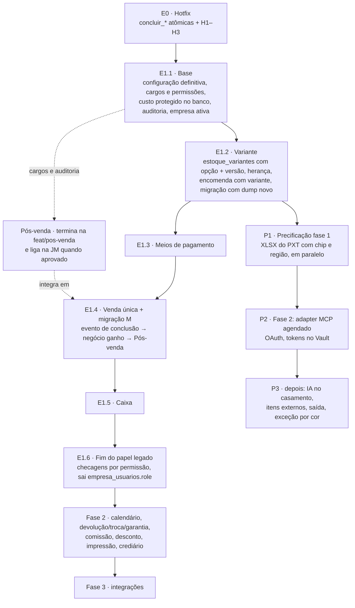

# Roteiro único: hotfix, PDV v2, variante, precificação e pós-venda

24/11/2026. Só documentação: nenhum código, migração ou dado alterado. A produção foi consultada só com `SELECT` e com a lista de migrações.

Este documento manda na **ordem**. O conteúdo de cada frente está em:

| Frente | Documento | Onde está hoje |
|---|---|---|
| Hotfix | commits `c21eca3a`, `e3cdf2cf` | branch `fix/entregar-sem-pagamento` |
| PDV v2 | [pdv-v2-especificacao.md](pdv-v2-especificacao.md) (revisão 3), [auditoria-pdv.md](auditoria-pdv.md), [reconciliacao-encomendas.md](reconciliacao-encomendas.md) | esta branch (`docs/roteiro-reconstrucao`) e a do hotfix |
| Variante | [unificacao-preco-proposta.md](unificacao-preco-proposta.md) (com o adendo de 24/11); plano de execução [etapa-1.2-variante-plano.md](etapa-1.2-variante-plano.md) (revisão 2, 26/11: opção + versão) | esta branch |
| Precificação | [precificacao-fornecedores-proposta.md](precificacao-fornecedores-proposta.md) (com o adendo); plano [precificacao-fase1-plano.md](precificacao-fase1-plano.md) (26/11) | esta branch |
| Pós-venda | `docs/design-pos-venda.md`, `docs/pos-venda-modelos-proposta-jm.md` | branch `feat/pos-venda` |

---

## 1. Situação em 24/11/2026

| Frente | Estado | Evidência |
|---|---|---|
| **Produção** | `main` = `origin/main` `4ee9da3e` (condição "usado" + `{{campo:chave}}`) | `git log origin/main` |
| **Hotfix** | **Não está na produção**: nem o código nem a migração `concluir_encomenda` (ausente da lista de migrações do banco) | `list_migrations`; branch 6 commits à frente e 34 atrás da `main` |
| **Etapa 1.1** | **Não começou.** Não existe branch. A configuração provisória (`config_valor`/`config_salvar` sobre `configuracoes_sistema`, migração `config_provisoria`) está na produção e foi feita para ter o corpo trocado pelo `empresa_config` definitivo, mantendo a assinatura | migração `20261123000500_config_provisoria` |
| **spike/niimbot-b2pro** | Página de teste da etiqueta pronta e compilando (biblioteca `@mmote/niimbluelib` 0.49.1, só dono/admin, em `/estoque/imei/etiqueta-teste`). **Não testada na impressora real.** Não vai para a `main` | `docs/spike-niimbot.md` na branch |
| **Pós-venda** | **Banco em produção** (todas as `posvenda_*`, mais `venda_exigida`, `sem_ofertas`, `condicao_usado`, `posvenda_ativar_existentes`). **App na `main`**, módulo "em preparação", **não ligado na JM**. A branch `feat/pos-venda` segue com os 8 itens do "100% pronto" (categorias próprias, calendário, repetição, campos da venda, uso estimado…) | lista de migrações; `core/modulos.ts`; memória do modo autônomo |
| **Variante** | Proposta com D1–D11 aprovadas. **26/11:** plano de execução na revisão 2, com a D2 revista (eixo "opção" + eixo "versão", cor agregada, preço por cor pendente dos sócios) | [unificacao-preco-proposta.md](unificacao-preco-proposta.md), [etapa-1.2-variante-plano.md](etapa-1.2-variante-plano.md) |
| **Precificação** | Proposta; espera a variante. **26/11:** plano da fase 1 (XLSX do PXT com chip e região) e da fase 2 (adapter MCP com OAuth; **condição do PXT cumprida em 26/11**: uso automatizado permitido). Revisão 2 do plano: "Disponibilidade" vazia = sem estoque, fora da base | [precificacao-fornecedores-proposta.md](precificacao-fornecedores-proposta.md), [precificacao-fase1-plano.md](precificacao-fase1-plano.md) |

### 1.1 O hotfix pronto para entrar?

- **Merge:** `git merge-tree` com a `main` atual dá **0 conflitos**. Só `types/database.gerado.ts` mudou dos dois lados, em blocos diferentes. O código depende só do que a própria migração cria.
- **Número da migração:** `20261119000100` é **anterior** às migrações já aplicadas (até `20261124184457`). Renumerar para o próximo número livre na hora do merge (regra de colisão), para o replay local seguir a ordem real.
- **App e migração sobem juntos.** O app do hotfix sem a migração quebra: o PDV grava `em_fechamento` e chama uma RPC que não existe.
- **Três ajustes antes de subir** (**aprovados em 24/11**; quem aplica é a sessão do hotfix). Eles saem da auditoria de preço congelado (§4.3):
  - **H1.** `concluir_encomenda` **sobrescreve `data_venda` com a data da entrega** (linha 253 da migração). Isso apaga a data original da venda. Proposta: **não sobrescrever**. A tela de comissão de hoje passa a usar `coalesce(concluida_em, data_venda)`: a encomenda continua contando no mês da entrega, que é o mês da quitação decidido, sem perder a data do pedido.
  - **H2.** A guarda `vendas_conclusao_guarda` só olha `status`. Acrescentar: **venda concluída não aceita UPDATE de `valor_venda`/`valor_custo` pela sessão** (só RPC). É a mesma trava que a 1.1 generaliza.
  - **H3.** A lista de encomendas abertas edita preço e custo filtrando só pelo `id`. Com o hotfix, entram nela também as vendas `pendente_entrega` do PDV e do orçamento por link. Restringir a edição a `status = 'encomenda'`.

---

## 2. Ordem única

| Etapa | Depende de | Pode rodar junto com |
|---|---|---|
| **E0 Hotfix** | nada | Pós-venda (não tocam nas mesmas tabelas) |
| **E1.1 Base** | E0 em produção (a 1.1 generaliza a guarda do hotfix) | Pós-venda |
| **E1.2 Variante** | E1.1: permissões de preço, auditoria e custo já fora da unidade | Pós-venda |
| **P1 Precificação** | E1.2 em produção até a 1.2c (variantes com preço e lista de versões da JM gravada) | E1.3, E1.4, E1.5 e Fase 2 (só toca no preço da variante, pela RPC da 1.2, e nas suas tabelas `precificacao_*`; a única mudança fora disso é a leitura protegida das chaves `precificacao.*` em `empresa_config` e `auditoria_eventos`, [precificacao-fase1-plano.md §8.3](precificacao-fase1-plano.md)) |
| **P2 Precificação (MCP)** | P1d em produção (a P2a pode ser construída junto da P1e/P1f); `rotinas_execucoes` da 1.1r. A permissão do PXT para o uso automatizado já foi dada (26/11, comprovação com o Lucas) | tudo |
| **E1.3 Meios de pagamento** | E1.1 | P1 |
| **E1.4 Venda única + M** | E1.2 (`vendas_itens.variante_id`), E1.3 | P1. **Pós-venda precisa estar estável**: a 1.4 passa a ganhar o negócio pela conclusão |
| **E1.5 Caixa** | E1.4 | P1 |
| **E1.6 Fim do papel legado** | E1.5 (todas as telas da Fase 1 já trocadas) | P1 |
| **Fase 2** | Fase 1 | P2 |
| **Pós-venda (terminar e ligar na JM)** | nada técnico das outras frentes; ligar depende da triagem dos 42 e do ok da simulação | tudo. Ele só lê `estoque_categorias` e só grava `negocios`/`posvenda_*` |

**Por que a variante entra antes do resto do PDV v2:**
- `vendas_itens` nasce com `variante_id`;
- o SKU e o código de barras nascem na variante (não no produto, para não migrar duas vezes);
- a encomenda já escolhe variante;
- a precificação pode começar cedo.

**Por que a 1.1 entra antes da variante:**
- a herança de preço precisa das permissões `estoque.preco_variante` e `estoque.preco_proprio` e da auditoria, para o histórico;
- o custo tem de estar protegido antes de a variante mexer nas telas de estoque.

**E1.6 Fim do papel legado** (registrado em 25/11, a pedido do Lucas): na 1.1 o cargo passa a definir o papel antigo (`empresa_usuarios.role`), para as 264 checagens de papel em ~115 arquivos continuarem certas sem trocar tudo de uma vez ([etapa-1.1-plano.md §2.2](etapa-1.1-plano.md)). Essa camada de compatibilidade **tem data para sair**: a E1.6, última etapa da Fase 1, troca o que sobrar por permissões e remove a coluna. Até lá, cada etapa troca as checagens das telas que mexer, e o contador `scripts/check-papel.mjs` (criado na 1.1b) só deixa o número cair.

**Gerador de valores padrão para empresa nova** (registrado em 25/11, a pedido do Lucas): na 1.1a, os padrões de configuração ficaram parte no catálogo (`lib/config.ts`) e parte no chamador (horário, dias úteis, liberação diária, sem ofertas). O gerador leva **todos** os padrões para o catálogo, gera deles os padrões usados pelas funções do banco e **materializa** as chaves marcadas na criação da empresa e na instalação de cada módulo (PDV v2 §A, "Padrões na criação"). Etapa de destino: **entrega 1.1i**, dentro da E1.1, depois da 1.1a (só depende do motor de configuração; pode correr em paralelo com 1.1b–1.1h). **Trava:** nenhuma empresa nova é cadastrada e a **Aletrini** não liga nenhum módulo com configuração (Pós-venda, distribuição, PDV, Estoque) antes de a 1.1i estar em produção.

**Pré-requisito da 1.1h** (registrado em 25/11, achado no deploy da 1.1a): antes de a 1.1h apagar o envelope provisório de `configuracoes_sistema`, as funções `core_horario` (lê `chave = 'core.horario'`) e `core_liberar_lotes_do_dia` (descobre as empresas por `chave = 'distribuicao.liberacao_diaria'`) passam a ler `empresa_config`. A busca de leitores antigos antes da 1.1h inclui o corpo das funções do banco (`pg_proc.prosrc`), não só o código do app.

### 2.1 Critérios de aceite resumidos

| Etapa | Pronto quando |
|---|---|
| **E0** | Prova SQL `prova-concluir-encomenda.sql` (18 casos) verde no replay local; e2e `entregar-pagamento-e2e` verde; H1–H3 com teste; na produção, uma encomenda real entregue pelo Histórico com saldo zero e `concluida_via = historico`; **nenhuma linha antiga de `vendas_vendas` alterada** (contagem e soma de `valor_venda`/`valor_custo`/`data_venda` iguais antes e depois da migração) |
| **E1.1i** | Todo padrão de configuração no catálogo (nenhum `padraoNoChamador`); empresa nova criada no local recebe as chaves materializadas e se comporta igual a uma empresa sem configuração gravada; teste que compara o padrão do catálogo com o das funções do banco |
| **E1.1** | Matriz de RLS cargos × ações verde; usuário **Vendedor** e **Consulta** não recebem custo em **nenhuma** rota, tela ou consulta (teste que procura `preco_custo`/`valor_custo`/`lucro`/`custo` nas respostas JSON de todas as rotas da lista do §B.1); **custo pendente** (PDV v2 §B.1): entrada sem a permissão, troca com custo automático = valor oferecido, lista "Unidades com custo pendente", venda com custo pendente preenchida **uma única vez** e auditada, segunda alteração sem efeito na venda; a conta "JM Store" no cargo Consulta, sem escrita; Matheus e Eduardo Dono; empresa nunca sem Dono; **conta "Meta Reviewer" desativada, com os 3 negócios e a conversa repassados ao Matheus na mesma migração do mapeamento de cargos**; `get_empresa_id()` determinístico; `auditoria_eventos` sem UPDATE/DELETE possível; impersonação registrada |
| **E1.2** | Diagnóstico com **dump do dia** refeito; prova "**0 unidades com preço efetivo diferente**" antes e depois da M2; propagação só em disponíveis que herdam (reservadas e vendidas intactas); veículos sem variante e sem mudança (§4.1); encomenda nova exige variante (com versão definida nas categorias que usam versão, se os sócios aprovarem); **variantes que diferem só na versão com preços independentes; versão fora da lista da categoria recusada no banco**; histórico de preço visível na Auditoria, sem custo; nenhuma venda, encomenda ou orçamento antigo alterado ([etapa-1.2-variante-plano.md §6](etapa-1.2-variante-plano.md)) |
| **P1** | XLSX real do PXT **com chip e região**: linhas lidas = arquivo, descartadas com motivo; nenhuma oferta em variante de outra versão; base = média das 3 menores com 2+ fornecedores conferida à mão em 3 variantes (inclusive "sem sugestão"); aprovação em lote grava só o preço da variante, auditado sem custo, herdeiras acompanham, reservadas e próprias intactas; reimportação recusada pelo hash; Vendedor e Consulta sem nenhum dado do módulo ([precificacao-fase1-plano.md §14](precificacao-fase1-plano.md)) |
| **P2** | OAuth feito uma vez pelo Lucas; tokens só no Vault, nunca em log, erro ou auditoria; senha do PXT nunca no Nexus; status conectado/expirado/revogado e aviso na página Rotinas quando a captura falha por autenticação; captura agendada da lista da JM criando importação e registrando execução em `rotinas_execucoes`; adapter só com ferramentas de leitura ([precificacao-fase1-plano.md §12](precificacao-fase1-plano.md)) |
| **E1.3** | Formas, maquininhas e taxas por empresa; Pix estático; taxas migradas de `financeiro_taxas` sem diferença |
| **E1.4** | Prova de totais do §M (inclusive R$ 596.707,50 das 92 da reconciliação como `pendencia_legado`); 23 leitores trocados no mesmo deploy; preço relido no servidor; **cada conclusão ganha o negócio com `dados.venda` e abre a jornada do Pós-venda uma vez só** (sem duplicar quando o negócio já estava ganho); smoke com empresa sem PDV |
| **E1.5** | Caixa abrir/sangrar/fechar cego; movimentos imutáveis |
| **E1.6** | Busca no código e no banco sem nenhum leitor de `empresa_usuarios.role` (nem `requireEmpresaRole*`, `getEmpresaRole`, `useSouAdmin`, `is_empresa_admin`); o gatilho que deriva o papel do cargo e a coluna `role` removidos; matriz de cargos da 1.1b verde |
| **Fase 2** | Testes T-H1a–k e T-H2 da comissão; prova de cancelamento/devolução; etiqueta impressa na B2 Pro |
| **Pós-venda ligado na JM** | O que o módulo já definiu: triagem, simulação aprovada, réguas da JM gravadas desativadas, depois ativadas |

---

## 3. Onde entram a precificação e o pós-venda

**Precificação** (plano: [precificacao-fase1-plano.md](precificacao-fase1-plano.md), 26/11):
- P1 começa quando a 1.2c estiver em produção (variantes com preço e a lista de versões da JM gravada). Entregas P1a (banco) → P1b (regras, equivalências, fontes) → P1c (importação do XLSX do PXT com chip e região, casamento, "Não encontrados") → P1d (cálculo, fila, aplicação) → P1e (automático e ligar na JM, com as decisões dos sócios) e P1f (XLSX genérico, JSON, retenção).
- **A regra de preço é do Nexus:** base = média das 3 menores ofertas com 2+ fornecedores (`costPrice`, `supplierCount`); margem em R$ ou % por categoria > subcategoria > marca > modelo > versão; arredondamento e variação máxima no motor de configuração da 1.1; o `sellingPrice` do PXT (regra + R$ 700 da própria conta da JM) só como comparação.
- Só escreve **na variante** (pela mesma RPC de preço, que audita, sem custo no `depois`) e nas suas tabelas `precificacao_*`. Por isso corre em paralelo com o resto da Fase 1 e da Fase 2 sem disputar arquivos, com duas exceções: o selo "sugestão pendente" na aba Produtos → Preços, que a E1.2 cria, e a leitura protegida das chaves `precificacao.*` (§8.3 do plano), que muda a política de leitura de `empresa_config` e `auditoria_eventos` sem efeito para o resto.
- **Respostas do PXT (26/11):** uso automatizado do MCP permitido (comprovação com o Lucas); não existe API oficial além do MCP; "Disponibilidade" vazia no XLSX = sem estoque no fornecedor (a oferta fica fora da base e aparece só como informação).
- A P2 (adapter MCP) segue logo depois da fase 1: P2a (conexão OAuth feita uma vez pelo Lucas, tokens criptografados no Vault, revogáveis, senha do PXT nunca guardada; tela de status) e P2b (captura agendada só de leitura da lista da JM, pelo relógio do pg_cron → `/api/cron/[job]`, registrada em `rotinas_execucoes` da 1.1r, com aviso na página Rotinas quando falha por autenticação).
- As decisões que dependem dos sócios estão no §13 do plano (margem decidida pela simulação da P1d, arredondamento, mínimo de fornecedores por versão, lista de versões, modo e variação máxima; e as que seguem abertas: preço por cor, produto fora do catálogo, acesso).

**Pós-venda:**
- Termina na própria branch, sem esperar nada.
- Liga na JM quando o Lucas aprovar. Até a E1.4, a jornada nasce do **modal de ganho** (manual), como hoje.
- Na E1.4, a conclusão atômica da venda passa a ganhar o negócio com `dados.venda` vindo da venda (PDV v2 §L.2), e o trigger do módulo continua igual.
- O PDV v2 **não** cria régua, tarefa de acompanhamento, NPS nem mensagem de pós-venda.

---

## 4. Regras transversais

### 4.1 Veículos ficam fora da variante e da herança

**Como veículos usam a tabela de unidades hoje:**
- O veículo é uma linha de `estoque_unidades` (`placa`, `chassi`, `renavam`, `km`, `ano`, `cor`, `condicao`), e o produto é o **modelo**.
- O **feed XML** dos portais (`/api/veiculos/[slug]`) lê `id, produto_id, ano, km, cor, condicao, preco_venda, fotos_urls, status` das disponíveis e o nome do produto. O preço é o `preco_venda` da unidade.
- O **match** lead × veículo lê `ano, km, cor, preco_venda, status` + produto/marca/categoria.
- O **contrato** é o único do sistema, com itens `{descricao, imei, valor}`. Não há contrato específico de veículo.
- Nenhum deles lê `armazenamento` ou custo.

**Decisão: veículo fica sem variante.**
1. A categoria com `tipo_formulario = 'veiculo'` não tem eixo de opção (`opcao_rotulo` vazio) e é marcada **"cada unidade é única"**: a regra vale para toda categoria assim marcada, não só para veículo.
2. Unidade dessas categorias: `variante_id` **nulo**, `preco_origem = 'proprio'` **sempre**. A RPC de preço recusa ligar variante a elas.
3. Os gatilhos de propagação só agem em `preco_origem = 'variante'`. Por construção, **nunca** tocam num veículo.
4. A coluna `preco_venda` continua sendo o preço do veículo, e o feed, o match e o contrato não mudam uma linha.
5. A **migração M2 da variante pula** as categorias "cada unidade é única". A trava geral da M2 (nenhuma unidade com preço efetivo diferente antes e depois) cobre o resto.
6. O PDV v2 continua sem tipo "veículo" (princípio 2). A Aletrini, se um dia vender pelo Nexus, usa o módulo de veículos.

**Prova de que nada muda para a Aletrini** (empresa 10, "Aletrini Multimarcas", consultada na produção em 24/11):

| Medida | Valor |
|---|---|
| Unidades de estoque | **0** |
| Produtos | **0** |
| Tabela de preços | **0** |
| Vendas (`vendas_vendas`) | **0** |
| Orçamentos | **0** |
| Categorias de estoque | nenhuma |
| Módulos ligados | `chat`, `fila` (nem estoque, nem PDV, nem avaliações) |
| Unidades com placa ou chassi, **em qualquer empresa** | **0** |
| Empresas com unidades de estoque | só a JM (57 unidades) |

- A variante, a herança, a proteção do custo e o PDV v2 alteram tabelas em que a Aletrini **não tem nenhuma linha**.
- Ela não tem os módulos que expõem essas telas.
- O feed de veículos exige o módulo `avaliacoes` ligado, que ela não tem.

**Critério de aceite fixo** (repetido no aceite de E1.1, E1.2 e E1.4), rodado na produção antes e depois de cada migração:
- contagem das linhas da empresa 10 em todas as tabelas `estoque_*`, `vendas_*`, `orcamentos_*` e `compras_*`;
- o XML do feed de uma empresa de teste com veículo, comparado byte a byte.

### 4.2 Pós-venda: o evento de conclusão

**O que existe:**
- O módulo dispara no **negócio ganho** (trigger `negocios_posvenda` → `posvenda_iniciar_jornadas`), com data, categoria e condição de `negocios.dados.venda`.
- **Não lê nem grava** tabela de venda, estoque ou preço. Só lê `estoque_categorias` (ids) e só grava `negocios` e `posvenda_*`.
- **Não usa** o evento de conclusão das funções atômicas, que hoje (hotfix) não dispara nada fora de `vendas_vendas`.

**Conflitos encontrados e resolução:**

| # | Conflito | Resolução |
|---|---|---|
| PV1 | Dois gatilhos possíveis (negócio ganho × venda concluída) | **Um só evento**, emitido dentro das funções atômicas de conclusão. Ele ganha o negócio com `dados.venda` montado da venda, e o trigger do Pós-venda faz o resto. A comissão usa o mesmo evento (data `quitada_em`, que é a conclusão, exceto no fiado). PDV v2 §L.2 |
| PV2 | §L.2 do PDV v2 criava "tarefas de pós-venda" e "mensagens de avaliação" por modelo: uma segunda régua | Removido do PDV v2. É o módulo Pós-venda |
| PV3 | O §I do PDV v2 se chamava "Pós-venda" (devolução, vale, garantia) | Renomeado para "Devolução, troca e garantia" |
| PV4 | Condição `seminovo` no PDV v2 (comissão, garantia, desconto, etiqueta) × `novo`/`usado` no Pós-venda | Tudo `novo`/`usado`; "seminovo" é rótulo (D3) |
| PV5 | Uma categoria por negócio × vários itens por venda | Item de maior valor (decisão D-P1) |
| PV6 | A trava `venda_exigida` (0900) recusaria o ganho feito por uma RPC sem `dados.venda` | A RPC grava `dados.venda` vindo da venda, então passa sem marca de exceção |
| PV7 | Data da jornada: digitada no modal × data da conclusão | `ganho_em = concluida_em`; `posvenda_jornadas.entrega_em = vendas.entregue_em` (a coluna já existe sem uso) |
| PV8 | Garantia: categoria "garantia" de chamado no Pós-venda × `vendas_garantias` no PDV v2 | Convivem: o chamado de garantia ganha um link opcional para a `vendas_garantias` da venda (Fase 2) |

### 4.3 Preço e custo congelados

**Regra:** item de venda, orçamento e encomenda guarda preço e custo do momento. Nada é recalculado depois.

**Única exceção** (decidida em 24/11): unidade vendida com **custo pendente** recebe na venda o custo informado depois, **uma vez só**, com auditoria (PDV v2 §B.1, etapa E1.1). Nenhuma outra mudança de custo atinge venda concluída.

Resultado da auditoria do hotfix e da `main`:

| # | O que não segue | Onde | Correção | Etapa |
|---|---|---|---|---|
| C1 | Custo da venda criada pela **aprovação do orçamento por link** = custo **atual** da unidade na hora da aprovação; o orçamento não guarda custo | `app/api/orcamento/[token]/route.ts` (aprovação tipo venda) | O orçamento passa a guardar `custo_unit` por item quando a unidade é escolhida (só visível com `estoque.ver_custo`); a aprovação copia o do orçamento | E1.4 (o orçamento vira `venda_fechar` com `origem = orcamento`) |
| C2 | Valor da troca exibido no PDV e no termo de garantia = `preco_custo` **atual** da unidade de troca, não o valor pago na troca | `pdv/page.tsx`, `garantia/page.tsx` | Ler `vendas_pagamentos.valor_pago` da troca | E1.1 (junto da proteção do custo) |
| C3 | Comissão de hoje aplica o **percentual atual** a cada abertura de tela | `equipe-view.tsx` | Substituída pelo motor da Fase 2 (fechamento grava `comissao_lancamentos` imutável) | Fase 2 |
| C4 | Encomenda e venda `pendente_entrega`: preço e custo editáveis até a entrega, por UPDATE só pelo `id` | `encomendas-abertas.tsx` | H3 no hotfix; na E1.4, ajuste só por RPC auditada (`encomenda_atualizar`) | E0 / E1.4 |
| C5 | Venda concluída: nada no banco impede UPDATE de `valor_venda`/`valor_custo` | guarda do hotfix olha só `status` | H2 no hotfix; na 1.1 a RLS de escrita some (só RPC) | E0 / E1.1 |
| C6 | `data_venda` sobrescrita na entrega | `concluir_encomenda` | H1 | E0 |
| C7 | **Custo 0** na encomenda (a venda nasce sem custo e a chegada não atualiza a venda) | `encomenda-form.tsx`, `/api/compras/receber` | Na E1.4, `encomenda_atualizar` (chegada) grava `vendas_itens_custos.custo_unit` com o custo do pedido de compra, **uma vez**, e congela; correção posterior só por ajuste auditado | E1.4 |
| C8 | Custo 0 no acessório digitado (PDV e entrega) e no downgrade por link (sem custo, sem unidade, sem produto) | `pdv-view.tsx`, `concluir_encomenda`, `orcamento/[token]` | Item livre continua sem custo, mas marcado `custo_conhecido = false`: os relatórios mostram "margem desconhecida", não 100%. O downgrade ganha `variante_id` e custo pela E1.4 | E1.4 |
| C9 | Espelho `itens.custo` legível por toda a empresa | gatilho `estoque_item_sync` | O espelho deixa de copiar custo (custo só na tabela protegida) | E1.1 |

**A migração não altera nenhuma venda ou encomenda antiga:**
- **E0** só acrescenta colunas.
- **E1.1** move o custo da **unidade** para a tabela protegida, copiando sem mudar o valor. O `valor_custo` das vendas antigas só tem a leitura restringida.
- **E1.2** não toca em venda.
- **E1.4** copia `vendas_vendas` para `vendas`/`vendas_itens` com a prova de totais e **mantém** a original como `_legado`. As 92 da reconciliação entram como `pendencia_legado`, sem pagamento inventado. Os itens legados ficam com `variante_id` **nulo**: nada é deduzido depois.

### 4.4 PDV aberto: conferir o preço no servidor (provisório)

**Até a E1.4:**
- O PDV de hoje monta as linhas no navegador, e o `concluir_venda_pdv` do hotfix só soma o que já foi gravado.
- O risco aumenta quando a variante entrar (E1.2), porque uma mudança de preço da variante passa a mudar as disponíveis na hora.

**Regra provisória, entregue junto da E1.2:**
1. Nova função `pdv_conferir_precos(p_itens jsonb)`, `STABLE`, só leitura: recebe unidade e preço mostrado e devolve as diferenças contra o preço efetivo atual.
2. O botão Finalizar chama a função **antes** de gravar as linhas. Se houver diferença, aparece "O preço de X mudou de R$ A para R$ B desde que você abriu o PDV. Atualizar e continuar?". O operador confirma, e o carrinho é recarregado com o preço novo.
3. O `concluir_venda_pdv` confere de novo, dentro da transação, que `valor_venda + desconto_valor` de cada linha = o preço efetivo da unidade. Se não bater, recusa com `PRECO_MUDOU`. Fecha a corrida entre a conferência e o insert.

Na E1.4, isso vira a releitura de preço dentro de `venda_fechar` (PDV v2 §C).

---

## 5. Conflitos entre os documentos e como ficou

| # | Documentos | Conflito | Resolução |
|---|---|---|---|
| D1 | PDV v2 §C × variante | `sku`/`ean` em `estoque_produtos` | Na variante (D10); retirado de `estoque_produtos` |
| D2 | PDV v2 §C × variante | `vendas_itens` sem variante | `variante_id`, `preco_origem` e preço efetivo congelado |
| D3 | PDV v2 §B × D9 | `pdv.ver_custo` só no PDV, sem trava no banco | `estoque.ver_custo` no núcleo do estoque, na 1.1, com o custo em tabelas protegidas (§B.1) |
| D4 | Variante × D11 | `estoque_precos_historico` próprio | Histórico na `auditoria_eventos` da 1.1 |
| D5 | Precificação × D11 | `precificacao_historico` próprio | Mesmo: auditoria |
| D6 | Precificação × variante | três destinos de preço e `precificacao_alvos` para o Nexus | Destino único = variante; alvos só para itens externos |
| D7 | Variante × D9 | `custo_referencia` na variante (custo visível a quem lê a variante) | Removido; o custo de mercado fica no módulo de precificação, protegido por `estoque.ver_custo` |
| D8 | PDV v2 §H × decisão de 24/11 | `momento = concluida` | `momento = quitada`, com `quitada_em` gravado pela RPC que zera o saldo |
| D9 | PDV v2 §H e §I × D3 | condição `seminovo` em filtros, garantia, etiqueta | `novo`/`usado`; `garantia.dias_usado`; `etiqueta_unidade` |
| D10 | PDV v2 §I e §L × Pós-venda | régua duplicada; nome "Pós-venda" | §4.2 (PV1–PV8) |
| D11 | PDV v2 "Plano de fases" × D11 | A Fase 1 ia direto de Base para Meios e Venda | Variante entra entre Base e Meios (E1.2); o roteiro prevalece |
| D12 | Hotfix × regra do preço congelado | `data_venda` sobrescrita; guarda só de status; edição por id | H1–H3 antes de subir |
| D13 | Hotfix × número de migração | `20261119000100` anterior às aplicadas | Renumerar no merge |
| D14 | Variante (proposta) × D5 | reservadas como decisão aberta | Reservadas não mudam |
| D15 | PDV v2 §B × cargos da JM | `owner` único hoje é a conta "JM Store" | Sócios viram Dono **antes** de a conta "JM Store" ir para Consulta; a empresa nunca fica sem Dono |
| D16 | PDV v2 §0.2 princípio 2 ("veículos não usam o PDV") × `estoque_unidades` compartilhada | variante e herança poderiam alcançar veículos | §4.1 |
| D17 | Variante D2 (um eixo) × achados do MCP do PXT (26/11) | a versão do aparelho (chip, origem, ANATEL) muda o preço até 21% no mesmo modelo, capacidade e cor | D2 revista: eixo "opção" + eixo "versão", opcionais por categoria; cor agregada, preço por cor pendente dos sócios ([etapa-1.2-variante-plano.md §2.2–2.3](etapa-1.2-variante-plano.md)) |
| D18 | Precificação (proposta) × 1.1 | `precificacao_regras` e o "+ R$ 700" como base | regras no motor de configuração da 1.1; o + R$ 700 é regra da conta da JM no PXT, não do PXT: o Nexus calcula pelo custo e mostra o `sellingPrice` só como comparação |

---

## 6. Isolamento entre sessões paralelas do Claude Code

**O que aconteceu em 24/11:**
- Esta sessão criou um banco `diag_preco` dentro da pilha Supabase local de outra sessão (`teste-local`, porta 56322).
- A outra sessão encerrou a pilha (`stop --no-backup`) no meio do trabalho, e o banco sumiu.
- Ninguém errou sozinho: não havia regra de posse. Pior: a rotina de fim de trabalho registrada nas passagens ("fechar o Docker, `wsl --shutdown`") **derruba a pilha de qualquer outra sessão**.

**Recomendação:**
1. **Uma worktree por sessão**, sempre (`.claude/worktrees/<tema>`). O checkout principal (`D:\Empresa TI\CRM-SaaS`) fica para o gate e o build e não recebe trabalho de sessão. Hoje ele está na `fix/entregar-sem-pagamento`, com documento não commitado de outra frente.
2. **Uma pilha local por sessão**, nomeada e com portas próprias:
   - `config.toml` da worktree com `project_id = "<tema>"`;
   - faixa de portas da sessão (ex.: 543xx, 553xx, 563xx);
   - subir e descer sempre com `--workdir` da própria worktree.

   **Nunca:**
   - criar banco ou schema na pilha de outra sessão;
   - `supabase stop` sem `--workdir`;
   - `docker stop`/`rm` de container que não seja seu.
3. **Registro de posse**, um arquivo fora do git, ex.: `D:\Empresa TI\CRM-SaaS\.claude\sessoes-locais.json`. Para cada pilha ou container de pé: `{ "pilha": "posvenda-teste", "sessao": "<id>", "worktree": "...", "portas": [...], "desde": "..." }`. Quem sobe registra; quem desce apaga **só a sua** linha.
4. **Docker e WSL só desligam quando o registro estiver vazio** e `docker ps` não mostrar pilha de outro nome. A frase "fechar Docker / `wsl --shutdown`" das passagens vira: "desligar **a minha** pilha; fechar o Docker só se não houver outra".
5. **Memória:** com teto de 4 GB no WSL, cabem no máximo duas pilhas Supabase. Para diagnóstico só de leitura, usar **um Postgres avulso** (`docker run` da imagem do Supabase, porta própria, nome `diag-<sessao>`, removido no fim), como foi feito aqui na segunda tentativa. Ele pesa uma fração da pilha completa.
6. **Números de migração:** além da conferência de hoje (todas as branches e worktrees), **reservar** o número no registro (`"migracoes_reservadas"`) no momento em que a sessão decide criá-lo.
7. **Stash compartilhado:** nunca `git stash` sem nome; preferir commit temporário na própria branch.

**Aprovado em 24/11 e aplicado:**
- as regras estão na memória do projeto (`isolamento-sessoes-locais`), e a rotina antiga de fechar o Docker foi corrigida na memória da máquina;
- o registro de posse foi criado em `D:\Empresa TI\CRM-SaaS\.claude\sessoes-locais.json`, fora do git, como o resto de `.claude/`.

---

## 7. Decisões que dependem do Lucas

### Respondidas em 24/11

| # | Tema | Decisão | Onde ficou |
|---|---|---|---|
| 1 | H1–H3 | Aprovados; entram no hotfix, aplicados pela sessão do hotfix | §1.1 |
| 2 | Loja Campinas | Em construção, não cadastrada; nada a fazer até abrir | PDV v2 §B |
| 3 | Valor da troca | Visível ao vendedor na negociação; protegido é o custo da unidade em estoque, venda e relatórios | PDV v2 §B.1 |
| 4 | Entrada sem ver custo | Permitida com custo pendente; troca preenche o custo com o valor oferecido; lista para quem vê custo; venda com custo pendente recebe o custo uma vez, auditado | PDV v2 §B.1, aceite da E1.1 |
| 5 | Conta "Meta Reviewer" | Desativar na E1.1, com os 3 negócios e a conversa para o Matheus | PDV v2 §B, aceite da E1.1 |
| 6 | Isolamento entre sessões | Aprovado e aplicado | §6 |
| 7 | Commit desta branch | Aprovado | — |

**A etapa 1.1 só começa depois do hotfix em produção.**

### Itens futuros (sem etapa)

- Limite de **valor de troca** com aprovação, configurável por empresa (PDV v2 §B.1).

### Ainda abertas

**Para a etapa 1.1b (antes do código da auditoria da plataforma):**

- **D-A1 — Auditoria sem dado pessoal de cliente em texto** (registrado em 25/11, a pedido do Lucas). A `auditoria_eventos` é imutável; um pedido de exclusão pela LGPD não conseguiria apagar nome, telefone ou CPF de cliente gravados em `antes`/`depois`. Proposta a decidir: a auditoria guarda só **identificadores** (tabela, id da linha, empresa, quem) e **os nomes dos campos alterados**; valores só de campos que não são dado pessoal (configuração, preço, custo, status, ids). Lista de campos pessoais por tabela (nome, telefone, e-mail, CPF/CNPJ, endereço, observação livre) mantida no código e conferida por teste. A gravação genérica da plataforma (1.1b) já nasce assim. Vale também para o que a 1.1a já grava: hoje só `config` (sem dado de cliente).

**Para a etapa 1.4 (pode esperar):**

8. **D-P1:** venda com vários itens = **uma** jornada de pós-venda, com a categoria do item de maior valor (recomendado) ou uma jornada por item?
9. **D-P2:** no fiado, a jornada começa na conclusão (produto entregue) e a comissão na quitação. Confirma?
10. **`crm.venda_troca_responsavel`:** quando a venda ganha um negócio que já tinha responsável diferente do vendedor, quem fica? Recomendado: o vendedor da venda, com o histórico do negócio registrando a troca.

**Para a Fase 2 (pode esperar):**

11. **D-C2:** AirPods como categoria própria (recomendado) ou filtro por produto na regra.
12. **D-C4:** estorno de venda comissionada devolvida. Padrão sugerido: na apuração seguinte.
13. **D-C5:** pagamento retroativo da reconciliação conta no mês em que o dinheiro entrou de fato (recomendado) ou no mês do lançamento.
14. **D-N1:** sábado como dia útil para a comissão. Padrão proposto: não.
15. Teste da página da Niimbot B2 Pro com a impressora da loja (a spike está pronta e não testada).
